# Comprehensive Blog Content Strategy & Topic Research (2026)
**Platform:** [GenerateCustomQR](https://generatecustomqr.com)  
**Target Locales:** English (`en`), Spanish (`es`), Portuguese (`pt`), German (`de`)  
**Domain Authority & Search Goals:** Establish topical authority in utility QR generation, privacy-first tooling, modern retail/marketing integration, and 2D barcode regulatory transitions (GS1 Sunrise 2027).

---

## Executive Summary & 2026 Market Analysis

The QR code search landscape has undergone a major paradigm shift in 2025–2026:
1. **From Curiosity to Operational Utility:** Searches have evolved from basic "what is a QR code" queries to high-intent operational searches: *"how to generate WhatsApp chat QR without saving contact"*, *"vCard 3.0 QR code formatting"*, and *"batch QR generation from CSV for inventory"*.
2. **The "Quishing" & Security Awakening:** Growing consumer awareness of QR phishing ("quishing") has made security, privacy, and zero-server logging a major conversion differentiator. Users actively search for *"secure QR code generator"* and *"is this QR code safe"*.
3. **The Global 2D Barcode Transition (GS1 Sunrise 2027 & EU DPP):** Global retail mandates to replace 1D UPC barcodes with 2D QR codes by 2027, along with the EU Digital Product Passport requirements, are creating massive B2B search demand for product packaging QR best practices.
4. **Frustration with Subscription Paywalls:** Millions of users search for free alternatives to platforms like QR Tiger or Beaconstac that charge $15–$50/month for basic features. Positioning **GenerateCustomQR** as the premier 100% free, client-side, privacy-first engine presents a massive acquisition moat.

---

## 🗺️ Topical Cluster Architecture

```mermaid
graph TD
    Hub["GenerateCustomQR Blog Hub"] --> C1["Cluster 1: Social & Messaging QR"]
    Hub --> C2["Cluster 2: Security & Privacy (Quishing)"]
    Hub --> C3["Cluster 3: 2027 Barcode & Packaging Revolution"]
    Hub --> C4["Cluster 4: Technical Mastery & Print Design"]
    Hub --> C5["Cluster 5: Free Tooling & Market Comparisons"]

    C1 --> A1["WhatsApp Chat QR"]
    C1 --> A2["Instagram Profile QR"]
    C1 --> A3["YouTube Channel QR"]

    C2 --> A4["What is Quishing & How to Prevent It"]
    C2 --> A5["Static vs Dynamic: The Privacy Debate"]

    C3 --> A6["GS1 Sunrise 2027: 2D Barcode Transition"]
    C3 --> A7["EU Digital Product Passport (DPP)"]
    C3 --> A8["Packaging & Label QR Best Practices"]

    C4 --> A9["QR Error Correction (L, M, Q, H) Explained"]
    C4 --> A10["Batch CSV QR Code Generation Guide"]
    C4 --> A11["Vector SVG vs 300 DPI PDF for Print"]

    C5 --> A12["Best Free QR Generators No Paywall (2026)"]
    C5 --> A13["vCard 3.0 Digital Business Card Guide"]
```

---

## 📑 15 Production-Ready Article Blueprints

---

### CLUSTER 1: Social Media & Channel Growth (High Search Volume & Commercial Intent)

#### Article 1: `qr-code-for-whatsapp.md`
- **Title:** How to Create a WhatsApp QR Code for Direct Chat (No Contact Save Required)
- **Primary Keyword:** `whatsapp qr code generator`
- **Secondary Keywords:** `qr code for whatsapp chat`, `wa me qr code`, `whatsapp business qr code free`, `generate whatsapp qr code with message`
- **Search Intent:** Commercial / How-To (Small business owners, customer support reps, freelancers)
- **Target Word Count:** 1,400 – 1,600 words
- **Target URL:** `/blog/qr-code-for-whatsapp`
- **Schema:** `Article`, `HowTo`, `FAQPage`
- **Internal Link Targets:** `/`, `/url-qr-code-generator`, `/how-to-use`

**Outline Breakdown:**
1. **Introduction:** The friction of manual number saving. How `wa.me` links encoded in QR codes allow 1-tap instant WhatsApp chat opening.
2. **How WhatsApp URL Schemes Work:** Deep dive into `https://wa.me/<number>?text=<encoded_message>`.
3. **Step-by-Step Guide to Generating a Custom WhatsApp QR Code:**
   - Step 1: Format the international phone number (E.164 without leading zeros or `+`).
   - Step 2: Pre-write an optional starter greeting (e.g., *"Hi! I'd like to book an appointment"*).
   - Step 3: Embed the official WhatsApp brand icon in the center with protective padding.
   - Step 4: Export in high-resolution vector SVG or 300 DPI PDF.
4. **Top 5 Business Use Cases:**
   - Countertop POS signage in retail stores
   - Food truck & restaurant ordering tables
   - Real estate property yard signs
   - Customer support business cards
   - Instagram / TikTok bio links
5. **Pro Tips for Print:** Why high contrast (green on white or black on green) and minimum 2×2 cm sizing are vital.
6. **FAQ Section:**
   - *Can people message me without adding me to their contacts?*
   - *Does this WhatsApp QR code expire?*
   - *Can I use this for WhatsApp Business and personal accounts?*

---

#### Article 2: `qr-code-for-instagram.md`
- **Title:** How to Make a Custom Instagram QR Code to Grow Followers & Engagement
- **Primary Keyword:** `instagram qr code generator`
- **Secondary Keywords:** `qr code for instagram profile`, `custom instagram qr code with logo`, `instagram nametag qr code free`
- **Search Intent:** Commercial / How-To (Influencers, creators, retail storefronts, event hosts)
- **Target Word Count:** 1,300 – 1,500 words
- **Target URL:** `/blog/qr-code-for-instagram`
- **Schema:** `Article`, `HowTo`, `FAQPage`
- **Internal Link Targets:** `/`, `/qr-code-with-logo`, `/url-qr-code-generator`

**Outline Breakdown:**
1. **Introduction:** Why standard Instagram in-app Nametags are limited, and why branded vector QR codes convert 3× higher on physical print assets.
2. **Deep-Linking to Instagram Profiles vs. Specific Posts / Reels:**
   - Profile link: `https://instagram.com/username`
   - Direct Reel / Promo Campaign links
3. **Designing an Aesthetic Instagram QR Code:**
   - Using Instagram's vibrant gradient colors (Purple `#833AB4`, Pink `#FD1D1D`, Yellow `#F56040`).
   - Adding circular dots and smooth corner frames.
   - Embedding the Instagram camera badge in the center.
4. **Where to Display Instagram QR Codes for Maximum ROI:**
   - Storefront window vinyl decals
   - Product thank-you packaging inserts
   - Restaurant table tents ("Tag us in your story for 10% off")
   - Event badges & conference roll-up banners
5. **FAQ Section:**
   - *Does the QR code open the Instagram app directly on mobile?*
   - *How do I ensure the Instagram logo doesn't block the scan?*

---

#### Article 3: `qr-code-for-youtube-channel.md`
- **Title:** How to Create a YouTube QR Code for Subscribers, Videos & Playlists
- **Primary Keyword:** `youtube qr code generator`
- **Secondary Keywords:** `qr code for youtube channel`, `youtube subscribe qr code`, `video qr code generator free`
- **Search Intent:** Informational / How-To (Content creators, educators, product marketers)
- **Target Word Count:** 1,200 – 1,400 words
- **Target URL:** `/blog/qr-code-for-youtube-channel`
- **Schema:** `Article`, `HowTo`, `FAQPage`
- **Internal Link Targets:** `/`, `/qr-code-with-logo`, `/url-qr-code-generator`

**Outline Breakdown:**
1. **Introduction:** Bridging the gap between physical products and digital video content.
2. **The "Auto-Subscribe" URL Trick:** How adding `?sub_confirmation=1` to your channel URL prompts visitors to subscribe in 1 click.
3. **Use Cases for Video QR Codes:**
   - Product instruction manuals (scanning opens assembly video tutorial)
   - Real estate virtual tour videos
   - Book authors adding video interviews to back covers
   - Event flyers with musical trailer previews
4. **Step-by-Step Design Guide:** Applying YouTube Red (`#FF0000`), embedding the play button logo, and downloading 300 DPI PDF for printing.
5. **FAQ Section.**

---

### CLUSTER 2: Security, Privacy & Cybersecurity (High E-E-A-T & Authority)

#### Article 4: `what-is-quishing-qr-code-phishing.md`
- **Title:** What is Quishing? How to Recognize & Protect Against QR Code Phishing Attacks (2026 Guide)
- **Primary Keyword:** `what is quishing`
- **Secondary Keywords:** `qr code phishing`, `how to prevent quishing`, `is this qr code safe`, `qr code security best practices`
- **Search Intent:** Informational / Security Guide (Enterprise IT, consumers, security-conscious web users)
- **Target Word Count:** 1,800 – 2,100 words
- **Target URL:** `/blog/what-is-quishing-qr-code-phishing`
- **Schema:** `Article`, `FAQPage`
- **Internal Link Targets:** `/qr-code-scanner`, `/`, `/privacy-policy`

**Outline Breakdown:**
1. **Introduction & The Threat Landscape:** Why quishing grew by over 300% in 2024–2025. How cybercriminals exploit the human trust in visual QR images.
2. **How Quishing Attacks Actually Work:**
   - Attack Vector 1: Malicious email attachments bypassing text-based spam filters.
   - Attack Vector 2: Physical sticker tampering on parking meters, public transit, and restaurant menus.
   - Attack Vector 3: Fake MFA / credential harvesting login portals.
3. **Why Quishing Bypasses Traditional Corporate Firewalls:**
   - Moves users from managed, monitored laptops to unmanaged personal mobile phones.
   - Optical encoding masks malicious URLs from traditional email gateway inspection.
4. **How to Detect a Malicious QR Code (Checklist for Users):**
   - Check the physical sticker for tampering / peeling.
   - Always verify the URL preview banner in your camera before tapping.
   - Look for domain spoofing (typosquatting like `paypa1.com` instead of `paypal.com`).
   - Use our free, private [QR Scanner](/qr-code-scanner) with client-side URL safety checks.
5. **Security Guidelines for Businesses Deploying QR Codes:**
   - Use branded, tamper-evident materials with permanent UV printing.
   - Publish QR codes on authenticated custom subdomains.
   - Avoid third-party redirection tracking services that could be hijacked or shut down.
6. **Why Static, Zero-Server QR Generators are Inherently Safer:**
   - Explain how GenerateCustomQR processes all encoding client-side with zero data storage.
7. **Comprehensive FAQ Section.**

---

#### Article 5: `static-vs-dynamic-qr-codes-privacy-security.md`
- **Title:** The Privacy & Longevity Trap: Why Static QR Codes Beat Dynamic Subscriptions for Permanent Assets
- **Primary Keyword:** `static vs dynamic qr code`
- **Secondary Keywords:** `do qr codes expire`, `free permanent qr code`, `qr code subscription trap`, `private qr code generator`
- **Search Intent:** Informational / Commercial Investigation (Business owners deciding how to print permanent assets)
- **Target Word Count:** 1,500 – 1,700 words
- **Target URL:** `/blog/static-vs-dynamic-qr-codes-privacy-security`
- **Schema:** `Article`, `FAQPage`
- **Internal Link Targets:** `/`, `/vcard-qr-code`, `/wifi-qr-code`, `/how-to-use`

**Outline Breakdown:**
1. **The Hidden Industry Reality:** The "Freemium QR Trap" where dynamic QR services offer "free" codes that stop working after 14 days or redirect to paywalls once printed on 10,000 product boxes.
2. **Technical Difference Explained:**
   - Static QR: Data is hard-coded directly into the geometric matrix. 100% offline, zero server dependency, works forever.
   - Dynamic QR: Code holds an intermediary URL redirecting through a third-party server.
3. **When Static QR is the Superior Choice:**
   - vCard business cards (offline address book save)
   - WiFi guest networks (zero-knowledge password security)
   - Permanent packaging, books, physical monuments, billboards
   - Sensitive government or medical documentation
4. **How to Get Analytics on Static QR Codes Without Subscriptions:**
   - Using Google Analytics UTM tags (`?utm_source=brochure&utm_medium=qr`) directly in the static link.
5. **Comparison Matrix: Static vs. Dynamic.**
6. **FAQ Section.**

---

### CLUSTER 3: 2027 Regulatory Transitions & Modern Packaging (High B2B Traffic & Backlink Magnet)

#### Article 6: `gs1-sunrise-2027-2d-barcode-transition.md`
- **Title:** GS1 Sunrise 2027 Explained: Why 2D QR Codes Are Replacing Traditional Barcodes at Retail Checkout
- **Primary Keyword:** `gs1 sunrise 2027`
- **Secondary Keywords:** `gs1 digital link qr code`, `2d barcode transition`, `qr code replacing barcode retail`, `gs1 qr code requirements`
- **Search Intent:** Informational / Enterprise B2B (CPG brands, retailers, packaging engineers)
- **Target Word Count:** 1,900 – 2,200 words
- **Target URL:** `/blog/gs1-sunrise-2027-2d-barcode-transition`
- **Schema:** `Article`, `FAQPage`
- **Internal Link Targets:** `/blog/qr-code-vs-barcode`, `/url-qr-code-generator`, `/qr-code-design-best-practices-for-print`

**Outline Breakdown:**
1. **The End of the 50-Year-Old 1D Barcode Era:** Background on the 1974 UPC barcode and why modern commerce has outgrown simple 12-digit numbers.
2. **What is GS1 Sunrise 2027?**
   - The global retail deadline for POS scanners to support 2D barcodes (QR code / GS1 DataMatrix) alongside 1D barcodes.
3. **What is GS1 Digital Link?**
   - Syntax: `https://brand.com/01/01234567890128/10/BATCH123?21=SERIAL456`
   - How a single QR code serves the checkout register (GTIN, price, expiry date) AND the consumer (ingredients, sustainability story, manuals).
4. **Key Benefits for Brands & Retailers:**
   - Expiration date enforcement at cash registers (prevents selling expired milk/pharmaceuticals).
   - Instant dynamic recall management by lot/batch number.
   - Decluttering package real estate (one 2D code replaces 3 separate symbols).
5. **How Packaging Designers Should Prepare Today:**
   - Print resolution & sizing rules (minimum 300 DPI, minimum 15×15 mm).
   - Contrast standards (ISO/IEC 15415 grading).
6. **FAQ Section.**

---

#### Article 7: `eu-digital-product-passport-qr-code-guide.md`
- **Title:** The EU Digital Product Passport (DPP): Compliance Dates, QR Code Standards & Requirements
- **Primary Keyword:** `digital product passport qr code`
- **Secondary Keywords:** `eu dpp compliance`, `product passport qr code requirements`, `espr qr code regulation 2027`
- **Search Intent:** Commercial / Regulatory Compliance (European manufacturers, fashion brands, electronics exporters)
- **Target Word Count:** 1,600 – 1,900 words
- **Target URL:** `/blog/eu-digital-product-passport-qr-code-guide`
- **Schema:** `Article`, `FAQPage`
- **Internal Link Targets:** `/url-qr-code-generator`, `/how-to-use`

**Outline Breakdown:**
1. **What is the EU Digital Product Passport (DPP)?** Under the Ecodesign for Sustainable Products Regulation (ESPR).
2. **Mandatory Timeline by Industry:**
   - February 2027: Industrial & Electric Vehicle Batteries.
   - 2027–2028: Apparel, Textiles & Footwear.
   - 2028–2030: Consumer Electronics, Plastics & Construction.
3. **Required Data Carriers:** Why 2D QR codes with open web protocols are the primary mandated carrier over proprietary chips.
4. **What Information Must Be Accessible via the QR Code:**
   - Material composition & recycled percentage
   - Carbon footprint & supply chain provenance
   - Repair manuals, spare part availability & recycling guidance
5. **Technical Guidelines for DPP QR Codes:**
   - Durability: Must withstand the product's entire lifecycle (e.g., washing machine cycles on clothing labels).
   - High-contrast vector generation for laser engraving and screen printing.
6. **FAQ Section.**

---

#### Article 8: `qr-code-for-product-packaging-labels.md`
- **Title:** QR Codes on Product Packaging: Complete Design, Sizing & Material Guide
- **Primary Keyword:** `qr code for product packaging`
- **Secondary Keywords:** `qr code on product label`, `packaging qr code design`, `qr code print resolution packaging`
- **Search Intent:** Commercial / Design Best Practice (Graphic designers, brand managers, FMCG businesses)
- **Target Word Count:** 1,500 – 1,700 words
- **Target URL:** `/blog/qr-code-for-product-packaging-labels`
- **Schema:** `Article`, `HowTo`, `FAQPage`
- **Internal Link Targets:** `/qr-code-design-best-practices-for-print`, `/qr-code-size-guide`, `/qr-code-color-guide`

**Outline Breakdown:**
1. **Why Product Packaging is the #1 Driver of QR Scans.**
2. **Placement Strategy:** Back-of-pack vs. side panel vs. bottle neck collar.
3. **Substrate & Material Challenges:**
   - Printing on glossy plastic / foil (avoiding light reflection issues).
   - Printing on curved surfaces (bottles, cans) — the 2D distortion rule.
   - Kraft paper & cardboard (ink bleed compensation).
4. **Sizing & Quiet Zone Formulas for Packaging.**
5. **Compelling Call-to-Action (CTA) Framing:** Moving beyond "Scan Me" to "Scan for Free Recipe Book" or "Scan to Verify Authenticity".
6. **Step-by-Step Guide using GenerateCustomQR:** Exporting print-ready PDF/SVG.
7. **FAQ Section.**

---

### CLUSTER 4: Technical Mastery & Engineering Deep Dives (Developer & High-Intent Search)

#### Article 9: `qr-code-error-correction-levels-explained.md`
- **Title:** QR Code Error Correction Explained: Levels L, M, Q, H & Logo Placement Math
- **Primary Keyword:** `qr code error correction`
- **Secondary Keywords:** `qr code error correction levels`, `reed solomon qr code`, `qr code level h error correction`, `qr code logo error correction`
- **Search Intent:** Informational / Technical (Developers, print specialists, technical designers)
- **Target Word Count:** 1,700 – 2,000 words
- **Target URL:** `/blog/qr-code-error-correction-levels-explained`
- **Schema:** `Article`, `FAQPage`
- **Internal Link Targets:** `/qr-code-with-logo`, `/how-to-use`, `/`

**Outline Breakdown:**
1. **Introduction:** How QR codes remain readable even when 30% of their surface is covered by dirt, scratches, or a company logo.
2. **The Mathematics of Reed-Solomon Error Correction:** How parity codewords restore damaged data blocks.
3. **Detailed Breakdown of the 4 Levels:**
   - **Level L (Low):** ~7% recovery. Best for dense URLs on tiny screens; simplest matrix pattern.
   - **Level M (Medium):** ~15% recovery. Standard default for general use.
   - **Level Q (Quartile):** ~25% recovery. Ideal for outdoor industrial environments with dust or wear.
   - **Level H (High):** ~30% recovery. **Mandatory for logo embedding.**
4. **The Trade-Off: Error Correction vs. Matrix Density:**
   - How higher error correction increases the module grid count (e.g., Version 2 → Version 4).
   - Why URL shortening combined with Level H produces the cleanest, easiest-to-scan logo QR codes.
5. **Safe Logo Embedding Math:**
   - Center placement rule (avoiding the 3 finder pattern corner eyes).
   - Safe logo bounding box formula: Logo width $\le 0.25 \times \text{QR width}$.
   - Protective white padding (quiet zone) around the logo.
6. **FAQ Section.**

---

#### Article 10: `batch-qr-code-generator-csv-guide.md`
- **Title:** How to Batch Generate 500+ QR Codes from CSV/Excel in Under 1 Minute (Free)
- **Primary Keyword:** `batch qr code generator`
- **Secondary Keywords:** `bulk qr code generator free`, `generate qr codes from excel`, `csv to qr code zip`, `mass qr code generator`
- **Search Intent:** Transactional / How-To (Event organizers, teachers, warehouse managers, IT admins)
- **Target Word Count:** 1,400 – 1,600 words
- **Target URL:** `/blog/batch-qr-code-generator-csv-guide`
- **Schema:** `Article`, `HowTo`, `FAQPage`
- **Internal Link Targets:** `/`, `/how-to-use`, `/vcard-qr-code`

**Outline Breakdown:**
1. **The Problem:** Generating hundreds of custom QR codes one by one is exhausting and error-prone.
2. **Top 5 Batch QR Code Use Cases:**
   - Event badges & conference ticket passes
   - Student ID cards & campus asset tags
   - Inventory warehouse bin labels
   - Real estate agent multi-property listing flyers
   - Product serial number stickers
3. **Preparing Your CSV / Excel Spreadsheet:**
   - Column 1: `Name` / `Identifier` (used for automated file naming)
   - Column 2: `URL` / `Data` / `vCard string`
4. **Step-by-Step Guide on GenerateCustomQR:**
   - Step 1: Switch to Batch Mode tab.
   - Step 2: Upload `.csv` or `.xlsx` file.
   - Step 3: Configure global styling (dot shape, colors, logo overlay).
   - Step 4: Click Generate & download bundled `.zip` of high-res PNG/SVG files.
5. **Performance & Privacy:** Why local in-browser batch processing is instant and secure (no sensitive data uploaded to servers).
6. **FAQ Section.**

---

#### Article 11: `svg-vs-png-vs-pdf-qr-code-export.md`
- **Title:** SVG vs PNG vs PDF: Which Format Should You Choose for Your QR Code?
- **Primary Keyword:** `svg vs png qr code`
- **Secondary Keywords:** `vector qr code download`, `qr code 300 dpi pdf`, `best format to print qr code`, `lossless qr code svg`
- **Search Intent:** Informational / Practical Decision Guide (Graphic designers, print buyers, web developers)
- **Target Word Count:** 1,300 – 1,500 words
- **Target URL:** `/blog/svg-vs-png-vs-pdf-qr-code-export`
- **Schema:** `Article`, `FAQPage`
- **Internal Link Targets:** `/how-to-use`, `/qr-code-design-best-practices-for-print`, `/`

**Outline Breakdown:**
1. **Introduction:** Why exporting the wrong file format ruins print jobs with pixelation or blurry edges.
2. **Format Comparison Breakdown:**
   - **Vector SVG:** Infinite resolution, editable in Illustrator/Figma, smallest file size, ideal for large billboards, banners, and digital web embeds.
   - **300 DPI PDF:** Universal print standard with embedded vector paths and strict color profiles, ideal for direct submission to commercial print shops.
   - **High-Res PNG (up to 4096px):** Raster format with transparent background support, ideal for Canva, social media templates, Word documents, and digital presentations.
3. **Decision Matrix: What Format to Pick for What Medium:**
   - Business cards → Vector SVG or 300 DPI PDF
   - Billboards & Roll-ups → Vector SVG
   - Website footer / Email signatures → PNG (512px)
   - Product boxes & foil stamping → Vector SVG (EPS convert)
4. **FAQ Section.**

---

### CLUSTER 5: Free Tooling, Alternatives & High-Converting Comparisons

#### Article 12: `best-free-qr-code-generators-2026.md`
- **Title:** 7 Best Free QR Code Generators with Logo (2026 Review — No Paywalls)
- **Primary Keyword:** `best free qr code generator`
- **Secondary Keywords:** `free qr code generator no watermark`, `qr code generator without signup`, `qr code monkey alternative`, `qr tiger free alternative`
- **Search Intent:** Commercial Investigation / Comparison (General users, marketing pros looking for genuine free tools)
- **Target Word Count:** 2,200 – 2,600 words
- **Target URL:** `/blog/best-free-qr-code-generators-2026`
- **Schema:** `Article`, `FAQPage`
- **Internal Link Targets:** `/`, `/free-qr-code-generator`, `/qr-code-with-logo`, `/how-to-use`

**Outline Breakdown:**
1. **The State of QR Generators in 2026:** How most "free" generators now lock vector exports or high resolutions behind expensive $20–$40/month subscriptions or insert spam ads.
2. **Evaluation Criteria:**
   - Truly 100% free with no watermarks
   - Customization depth (dot styles, eye shapes, color gradients, frames)
   - Export formats (SVG, PDF, high-res PNG)
   - Logo embedding & auto error correction
   - Privacy & data collection practices
3. **In-Depth Tool Reviews:**
   - **1. GenerateCustomQR (Editor's Choice):** 100% free, 39 dot styles, 51 text frames, 121 templates, client-side zero-server privacy, batch CSV, SVG/PDF exports with zero signup.
   - **2. QRCode Monkey:** Great legacy tool, but cluttered with third-party ads and lacks batch CSV features.
   - **3. QR Tiger:** Powerful dynamic features, but heavy paywalls and watermark on free tier.
   - **4. Canva QR Code App:** Convenient for Canva users, but limited to square dots and basic colors.
   - **5. Adobe Express QR:** Clean UI, but requires an Adobe account and lacks advanced eye/dot customization.
4. **Comprehensive Feature Comparison Table.**
5. **FAQ Section.**

---

#### Article 13: `vcard-3-digital-business-card-guide.md`
- **Title:** How to Make a vCard QR Code: The Complete Digital Business Card Guide (2026)
- **Primary Keyword:** `how to make a vcard qr code`
- **Secondary Keywords:** `vcard qr code format`, `digital business card qr code free`, `save contact qr code iphone android`, `vcf qr code generator`
- **Search Intent:** How-To / Commercial (Professionals, sales teams, executives, freelancers)
- **Target Word Count:** 1,600 – 1,800 words
- **Target URL:** `/blog/vcard-3-digital-business-card-guide`
- **Schema:** `Article`, `HowTo`, `FAQPage`
- **Internal Link Targets:** `/vcard-qr-code`, `/blog/how-to-add-qr-code-to-business-card`, `/`

**Outline Breakdown:**
1. **The Modern Networking Dilemma:** Why 88% of paper business cards get thrown away within a week.
2. **How vCard 3.0 Formatting Works Behind the Scenes:**
   - Demonstrating the raw `.vcf` string structure (`BEGIN:VCARD`, `FN:`, `ORG:`, `TEL:`, `EMAIL:`, `URL:`, `END:VCARD`).
3. **1-Tap Save on iPhone & Android:** How native camera apps parse vCards without requiring third-party apps.
4. **Formatting Best Practices to Prevent Dense QR Codes:**
   - Avoiding giant multiline notes or oversized strings that make the QR pattern too dense.
   - Prioritizing essential fields: Name, Title, Company, Mobile, Email, Website.
5. **Designing a Luxury Card Layout:** Minimalist card styling, quiet zones, and spot UV / foil stamping considerations.
6. **FAQ Section.**

---

#### Article 14: `qr-code-for-wifi-complete-guide.md`
- **Title:** How to Create a WiFi QR Code for Guests & Customers (WPA3 & Hidden Networks)
- **Primary Keyword:** `how to create a wifi qr code`
- **Secondary Keywords:** `wifi qr code wpa3`, `connect to wifi with qr code`, `guest wifi qr code table tent`, `free wifi qr code generator`
- **Search Intent:** How-To / Informational (Cafe owners, Airbnb hosts, office managers, homeowners)
- **Target Word Count:** 1,400 – 1,600 words
- **Target URL:** `/blog/qr-code-for-wifi-complete-guide`
- **Schema:** `Article`, `HowTo`, `FAQPage`
- **Internal Link Targets:** `/wifi-qr-code`, `/blog/wifi-qr-code-for-hotels`, `/`

**Outline Breakdown:**
1. **Ending the "What's the WiFi Password?" Nightmare.**
2. **The Technical Anatomy of the `WIFI:` URI Protocol:**
   - `WIFI:T:WPA;S:MyNetwork;P:SuperSecretPass;H:false;;`
   - Support for WPA3, WPA2-PSK, WEP, and Open Networks.
   - How hidden SSIDs (`H:true`) are handled by iOS and Android.
3. **Security & Zero-Knowledge Verification:** Why entering WiFi passwords on cloud-based QR generators is a security risk, and why client-side generation in GenerateCustomQR protects your network.
4. **Displaying WiFi QR Codes Professionally:**
   - Acrylic table tents for cafes and restaurants
   - Welcome binders and fridge magnets for Airbnb / vacation rentals
   - Meeting room wall plaques in corporate offices
5. **FAQ Section.**

---

#### Article 15: `qr-code-for-events-calendar-rsvp.md`
- **Title:** How to Use Event QR Codes for 1-Tap Calendar Invites (iCal / Google Calendar)
- **Primary Keyword:** `event qr code generator`
- **Secondary Keywords:** `qr code for calendar event`, `ical qr code`, `add to google calendar qr code`, `event rsvp qr code`
- **Search Intent:** How-To / Commercial (Event planners, wedding organizers, concert venues, webinar hosts)
- **Target Word Count:** 1,300 – 1,500 words
- **Target URL:** `/blog/qr-code-for-events-calendar-rsvp`
- **Schema:** `Article`, `HowTo`, `FAQPage`
- **Internal Link Targets:** `/event-qr-code`, `/url-qr-code-generator`, `/`

**Outline Breakdown:**
1. **Eliminating Missed Appointments & Event No-Shows:** How direct calendar integration boosts attendance rates by 40%.
2. **The Two Types of Event QR Codes:**
   - **Offline iCal (.ics / VEVENT):** Works without internet; adds title, start/end time, location, and description directly to Apple Calendar / Outlook.
   - **Online Google Calendar Link:** Opens Google Calendar web / app with pre-filled event fields.
3. **Top Use Cases:**
   - Wedding invitations & save-the-date cards
   - Live music gigs & festival flyers
   - Academic conferences & workshops
   - Real estate open house schedules
4. **Step-by-Step Event Setup Guide.**
5. **FAQ Section.**

---

## 📅 90-Day Editorial & Publishing Roadmap

| Phase / Sprint | Articles to Write & Publish | Target Keywords | Expected Impact |
| :--- | :--- | :--- | :--- |
| **Month 1 (Days 1–30): Social & Free Tooling Hub** | • `best-free-qr-code-generators-2026.md` • `qr-code-for-whatsapp.md` • `qr-code-for-instagram.md` • `qr-code-for-youtube-channel.md` | `best free qr code generator`, `whatsapp qr code generator`, `instagram qr code generator` | Captures high-volume transactional user intent and provides immediate competitor alternatives. |
| **Month 2 (Days 31–60): Security & Tech Mastery** | • `what-is-quishing-qr-code-phishing.md` • `static-vs-dynamic-qr-codes-privacy-security.md` • `qr-code-error-correction-levels-explained.md` • `batch-qr-code-generator-csv-guide.md` • `svg-vs-png-vs-pdf-qr-code-export.md` | `what is quishing`, `static vs dynamic qr code`, `qr code error correction`, `batch qr code generator` | Builds top-tier E-E-A-T domain authority in security, developer, and designer communities. |
| **Month 3 (Days 61–90): Enterprise, 2027 Standards & Utilities** | • `gs1-sunrise-2027-2d-barcode-transition.md` • `eu-digital-product-passport-qr-code-guide.md` • `qr-code-for-product-packaging-labels.md` • `vcard-3-digital-business-card-guide.md` • `qr-code-for-wifi-complete-guide.md` • `qr-code-for-events-calendar-rsvp.md` | `gs1 sunrise 2027`, `digital product passport qr code`, `qr code for product packaging`, `how to make a vcard qr code` | Positions site for high-value B2B packaging, retail transition traffic, and high-converting utility queries. |

---

## 🌍 Multilingual Localization Strategy (ES, PT, DE)

To dominate European and Latin American markets, all articles should be published simultaneously across `es`, `pt`, and `de` with localized search terms and cultural context:

### Spanish (`es`) Keyword Variations:
- WhatsApp: `generador de codigo qr para whatsapp`, `crear qr de whatsapp directo`
- Quishing: `que es el quishing`, `como evitar estafas con codigos qr`
- Sunrise 2027: `transicion a codigos 2d gs1 2027`, `pasaporte digital de productos ue`
- Free Tool: `mejor generador de codigos qr gratis sin registro`

### Portuguese (`pt`) Keyword Variations:
- WhatsApp: `gerador de qr code para whatsapp gratis`, `qr code wa me conversa direta`
- Business Card: `como criar cartao de visita digital vcard qr code`
- Batch CSV: `gerador de qr code em lote gratis csv`
- Security: `o que e quishing golpe do qr code`

### German (`de`) Keyword Variations:
- Technical/B2B: `gs1 sunrise 2027 2d barcode umstellung`, `digitaler produktpass qr code eu`
- WiFi/Error Correction: `wlan qr code erstellen gastnetzwerk`, `qr code fehlerkorrektur level h`
- Vector Print: `qr code als svg oder pdf drucken 300 dpi`

---

## 🔗 Internal Linking Architecture Rules

Every new blog article must strictly adhere to the following internal linking framework:
1. **Primary Landing Page Link (in First 150 Words):** Direct anchor text link to the corresponding tool page (e.g., [Free vCard QR Code Generator](/vcard-qr-code) or [URL to QR Code Generator](/url-qr-code-generator)).
2. **Related Guides Block (Bottom of Article):** Three contextual links to complementary blog posts within the same topical cluster.
3. **How-To Guide Link:** At least one link pointing to the master [How to Make a QR Code](/how-to-use) guide.
4. **Call to Action (CTA) Banner:** Persistent bottom card driving readers directly into the [Generator Studio](/) with all features unlocked.
