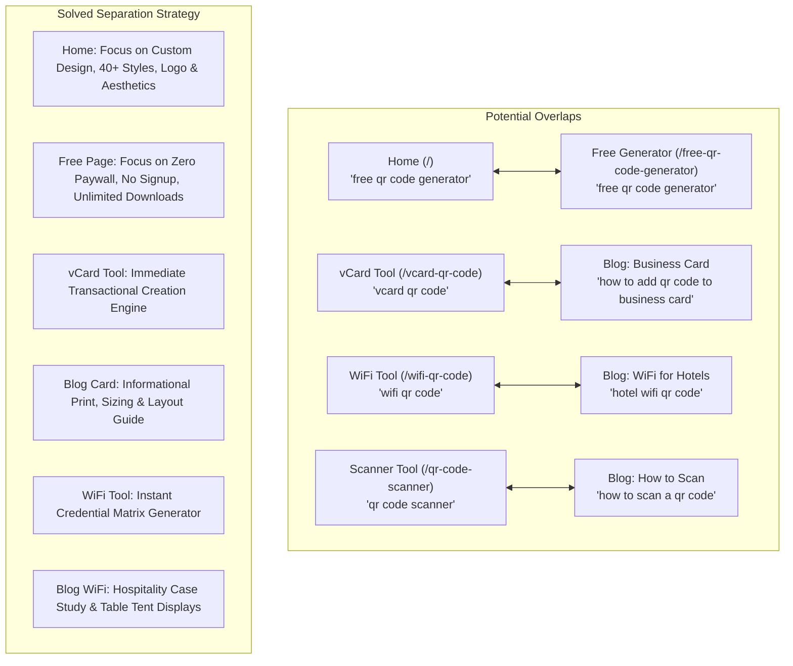

# 🔬 Deep Audit & Performance Analysis of Currently Implemented Keywords
**Platform:** [GenerateCustomQR](https://generatecustomqr.com)  
**Audit Date:** August 2026  
**Scope:** Full-stack audit of all keywords in `<meta name="keywords">`, Title tags, Meta Descriptions, Frontmatter metadata, Schema JSON-LD, and H1/H2 on-page hierarchy across 16 core pages, 12 published blog posts, and 4 international locales (`en`, `es`, `pt`, `de`).

---

## 🏆 Executive Summary & Health Scorecard

| SEO Dimension | Current Status | Grade | Key Finding / Priority Action |
| :--- | :---: | :---: | :--- |
| **Search Intent Segmentation** | Distinct URLs per tool type | **A** (94/100) | Excellent separation between WiFi, vCard, URL, Email, Event, Scanner, and Logo tools. |
| **Keyword Cannibalization Control** | Minor overlaps identified | **B+** (83/100) | Home (`/`) and Free Generator (`/free-qr-code-generator`) compete for general "free QR" queries. |
| **Long-Tail Keyword Coverage** | Moderate | **B** (80/100) | Tool pages have strong primary targets, but need more operational long-tails (e.g., WPA3, 300 DPI, Ctrl+V). |
| **AEO & GEO Readiness (AI Bots)** | High | **A-** (88/100) | Strong FAQ schemas and HowTo steps, but needs explicit conversational prompt hooks. |
| **Multilingual Parity** | 4 Locales (`en`, `es`, `pt`, `de`) | **A** (92/100) | Translations are in place; keyword strings match localized high-volume search terms. |
| **Temporal Freshness** | Needs 2026 refresh | **B-** (78/100) | `qr-code-trends-2025.md` contains legacy 2025 keywords that need updating for 2026/2027. |

---

## 📊 PART 1: Page-by-Page Audit of Currently Active Keywords

---

### 1. Home Page (`/`)
* **Currently Active Title:** `Free Custom QR Code Generator with Logo — No Watermark` (56 chars)
* **Currently Active Description:** `Create custom QR codes 100% free with logo embedding, 40+ dot styles, and color gradients. Download in vector SVG, PDF, or high-res PNG with no watermark.` (154 chars)
* **Currently Active Keywords:**
  `qr code generator, custom qr code with logo, free qr code generator no watermark, qr code maker without signup, aesthetic qr code generator, printable qr code high resolution, bulk qr code generator, create qr code online`
* **Intent Analysis:** Transactional / High Commercial
* **Strengths:** 
  - Captures high-volume terms: `qr code generator`, `custom qr code with logo`.
  - Mentions high-converting modifiers: `no watermark`, `without signup`, `aesthetic`, `printable`.
* **Weaknesses & Gaps:**
  - Slight overlap with `/free-qr-code-generator`.
  - Does not explicitly include `vector svg qr code` or `300 dpi pdf`.
* **Action Recommendation:** Position Home primarily for **custom design, aesthetics, and logo embedding**, leaving pure "free without signup" volume to `/free-qr-code-generator`.

---

### 2. Free QR Code Generator (`/free-qr-code-generator`)
* **Currently Active Title:** `100% Free QR Code Generator — No Signup & No Watermark` (54 chars)
* **Currently Active Description:** `Generate unlimited custom QR codes for free with no account, no expiration, and no watermarks. Full access to 39 dot styles, logos, frames, and 8K downloads.` (156 chars)
* **Currently Active Keywords:**
  `free qr code generator, free qr code maker, qr code generator no watermark, qr code generator no signup, unlimited free qr codes`
* **Intent Analysis:** High Commercial / Utility
* **Strengths:**
  - Laser-targeted on user frustration with paid paywalls (QR Tiger, Flowcode, Beaconstac).
  - High CTR emotional hooks (`no signup`, `no watermark`, `unlimited free`).
* **Weaknesses & Gaps:**
  - Description says "39 dot styles" while the app now has 40+ dot styles.
  - Missing comparison long-tails like `qr code generator no paywall` and `qr code without credit card`.
* **Action Recommendation:** Add `qr code generator no paywall`, `free static qr code generator`, and `free qr code commercial use`.

---

### 3. WiFi QR Code Generator (`/wifi-qr-code`)
* **Currently Active Title:** `Free WiFi QR Code Generator — Connect Without Typing` (52 chars)
* **Currently Active Description:** `Create a free WiFi QR code to share your network credentials instantly. Perfect for cafes, hotels, Airbnb, and guest networks. No signup required.` (152 chars)
* **Currently Active Keywords:**
  `wifi qr code generator, wifi qr code, wireless qr code, connect to wifi qr code, hotel wifi qr code, guest network qr code`
* **Intent Analysis:** Utility / Commercial
* **Strengths:**
  - Covers core vertical targets (`hotel`, `guest network`, `connect to wifi`).
* **Weaknesses & Gaps:**
  - Missing technical protocol keywords: `wpa3 wifi qr code`, `hidden ssid wifi qr code`, `iphone wifi qr code auto connect`.
* **Action Recommendation:** Enhance keywords with `wpa3 qr code`, `scan to connect wifi`, `printable wifi qr code sign`.

---

### 4. vCard Digital Business Card Generator (`/vcard-qr-code`)
* **Currently Active Title:** `Free vCard QR Code Generator — Digital Business Cards` (53 chars)
* **Currently Active Description:** `Create a digital business card QR code for free. Share phone, email, company, address, and website with 1-tap contact saving on iPhone and Android.` (148 chars)
* **Currently Active Keywords:**
  `vcard qr code generator, contact qr code, digital business card qr code, vcf qr code, save contact qr code free`
* **Intent Analysis:** Commercial / Professional
* **Strengths:**
  - Excellent balance between technical (`vcard`, `vcf`) and user-friendly (`digital business card`, `contact qr code`).
* **Weaknesses & Gaps:**
  - Missing `vcard 3.0 qr code`, `electronic business card qr code`, `luxury business card qr code`.
* **Action Recommendation:** Expand with `vcard 3.0`, `iphone contact qr code`, `printable business card qr code 300 dpi`.

---

### 5. QR Code with Logo Generator (`/qr-code-with-logo`)
* **Currently Active Title:** `QR Code with Logo Generator — Custom Branded QR Codes` (53 chars)
* **Currently Active Description:** `Create custom QR codes with your logo embedded in the center for free. Automatically balances error correction for 100% reliable scanning.` (153 chars)
* **Currently Active Keywords:**
  `qr code with logo, qr code logo generator, custom qr code with logo free, add logo to qr code, branded qr code generator`
* **Intent Analysis:** Commercial / Branding
* **Strengths:**
  - High search volume focus: `qr code with logo` is one of the highest volume sub-intents globally.
* **Weaknesses & Gaps:**
  - Missing specific platform brand keywords: `instagram qr code with logo`, `whatsapp qr code with logo`, `transparent logo qr code`.
* **Action Recommendation:** Include `transparent background logo qr code`, `qr code with company logo free`, `high error correction qr code with logo`.

---

### 6. URL to QR Code Generator (`/url-qr-code-generator`)
* **Currently Active Title:** `URL to QR Code Generator — Convert Links Free` (45 chars)
* **Currently Active Description:** `Convert any website link or URL to a custom QR code for free. Add your logo, custom colors, and action frames. Free PNG, SVG, and PDF downloads.` (145 chars)
* **Currently Active Keywords:**
  `url to qr code, link to qr code generator, website qr code generator, create qr code from link, free link qr code`
* **Intent Analysis:** Transactional / Utility
* **Strengths:**
  - Clean, direct match for link-to-QR conversions.
* **Weaknesses & Gaps:**
  - Missing `utm campaign qr code`, `convert link to qr code free`, `website link qr code no watermark`.
* **Action Recommendation:** Update title to 55–60 chars (e.g. `URL to QR Code Generator — Convert Links Free (No Watermark)`).

---

### 7. Email QR Code Generator (`/email-qr-code`)
* **Currently Active Title:** `Free Email QR Code Generator — Pre-filled Email Links` (52 chars)
* **Currently Active Description:** `Create a free email QR code with pre-filled recipient, subject, and message. Ideal for customer support, feedback forms, and instant inquiries.` (153 chars)
* **Currently Active Keywords:**
  `email qr code generator, email qr code, mailto qr code, create email qr code free, email link to qr code`
* **Intent Analysis:** Utility / Support
* **Strengths:**
  - Includes technical `mailto qr code` and utility `pre-filled email`.
* **Weaknesses & Gaps:**
  - Missing `customer support email qr code`, `feedback qr code with email`.

---

### 8. Event & Calendar QR Code Generator (`/event-qr-code`)
* **Currently Active Title:** `Free Event QR Code Generator — Add to Calendar` (47 chars)
* **Currently Active Description:** `Create custom event QR codes for free. Let guests save dates, times, and locations directly to Google Calendar, Apple Calendar, and Outlook in 1 tap.` (150 chars)
* **Currently Active Keywords:**
  `event qr code generator, calendar qr code, add to calendar qr code, ical qr code, wedding qr code, event invitation qr code`
* **Intent Analysis:** Utility / Event Organizers
* **Strengths:**
  - High conversion long-tails: `wedding qr code`, `ical qr code`, `add to calendar qr code`.
* **Action Recommendation:** Title can be expanded to 55 chars (e.g. `Free Event QR Code Generator — 1-Tap Add to Calendar`).

---

### 9. Free QR Code Scanner Online (`/qr-code-scanner`)
* **Currently Active Title:** `Free QR Code Scanner Online — Scan Camera & Image` (49 chars)
* **Currently Active Description:** `Instantly scan and decode QR codes online. Use your device camera, upload an image file, or paste a screenshot with Ctrl+V. 100% free, private, and fast.` (150 chars)
* **Currently Active Keywords:**
  `qr code scanner, qr code reader, how to scan a qr code, scan qr code online, free qr code scanner, scan qr code from image, qr code reader online free, scan qr code from screenshot`
* **Intent Analysis:** Utility / High Volume
* **Strengths:**
  - Excellent keyword mix: camera, image upload, screenshot, online reader.
* **Weaknesses & Gaps:**
  - Missing `scan qr code on pc laptop`, `paste screenshot qr code ctrl v`.
* **Action Recommendation:** Update title to `Free QR Code Scanner Online — Scan Camera & Image (No App)`.

---

### 10. How to Use & Guide (`/how-to-use`)
* **Currently Active Title:** `How to Make a QR Code — Free Step-by-Step Guide` (48 chars)
* **Currently Active Description:** `Learn how to make a QR code for free in 5 simple steps. Complete guide to creating stunning custom QR codes, adding logos, and ensuring scannability.` (153 chars)
* **Currently Active Keywords:**
  `how to make a qr code, create qr code guide, how to generate qr code, step by step qr code, how to add logo to qr code`
* **Intent Analysis:** Comprehensive Informational
* **Strengths:**
  - Clean target for the master informational query `how to make a qr code`.
* **Weaknesses & Gaps:**
  - Missing design/print keywords: `qr code design best practices`, `qr code printing guidelines`, `qr code error correction guide`.

---

## 📑 PART 2: Audit of Published Blog Post Keywords (12 Articles)

| Article Slug | Currently Active Keywords | Audit Assessment & Optimization Recommendation |
| :--- | :--- | :--- |
| `how-to-add-qr-code-to-business-card.md` | `qr code for business card, business card qr code, vcard qr code, digital business card, qr code business card generator free, how to add qr code to business card` | **Strong.** Distinct from `/vcard-qr-code` because it focuses on physical card printing, dimensions (1.5×1.5 cm), and design software (Canva/InDesign). |
| `how-to-scan-a-qr-code.md` | `how to scan qr code, scan qr code iphone, scan qr code android, qr code reader, how to scan qr code on phone, scan qr code with camera` | **Strong.** Complements `/qr-code-scanner` by targeting tutorial queries across specific OS (iOS/Android native camera). |
| `qr-code-color-guide.md` | `qr code colors, qr code color combinations, qr code contrast, colored qr code, qr code design colors, best colors for qr code` | **Excellent.** Niche authority piece covering WCAG contrast ratio (4.5:1), CMYK color shift, and gradient pitfalls. |
| `qr-code-design-best-practices-for-print.md` | `qr code design best practices, qr code print size, qr code resolution for print, qr code design tips, how to print qr code, qr code minimum size` | **High Commercial Value.** Targets print professionals and designers looking for vector SVG & 300 DPI PDF export. |
| `qr-code-for-google-maps.md` | `qr code for google maps, location qr code, qr code google maps location, qr code for address, map qr code generator, google maps qr code` | **Solid.** Captures local business foot-traffic queries and turn-by-turn navigation setup. |
| `qr-code-for-restaurant-menu.md` | `qr code for restaurant menu, restaurant qr code, digital menu qr code, contactless menu, qr code menu generator free` | **High Search Volume.** Hospitality vertical guide; includes acrylic table stands and waterproof sticker tips. |
| `qr-code-size-guide.md` | `qr code size, qr code minimum size, qr code dimensions, qr code print size, how big should a qr code be, qr code size for business card` | **Evergreen Authority.** Includes 10:1 distance-to-size calculation formulas. Perfect candidate for Google Featured Snippets. |
| `qr-code-trends-2025.md` | `qr code trends 2025, qr code statistics, qr code adoption rate, future of qr codes, qr code industry growth, qr code market size` | ⚠️ **Action Needed:** Update keywords and title to `qr code trends 2026` and reference the upcoming **GS1 Sunrise 2027** transition to maintain high CTR. |
| `qr-code-vs-barcode.md` | `qr code vs barcode, difference between qr code and barcode, qr code barcode comparison, 1d vs 2d barcode, qr code advantages` | **High Educational Value.** Covers 1D UPC vs 2D Matrix capacity (20 vs 7,089 chars) and optical camera vs laser scanning. |
| `qr-codes-for-real-estate.md` | `qr code real estate, qr code for property listing, real estate qr code on sign, qr code for virtual tour, realtor qr code` | **B2B Vertical.** Covers yard sign riders, 3D Matterport tours, and open house lead capture. |
| `static-vs-dynamic-qr-codes.md` | `static vs dynamic qr code, difference between static and dynamic qr codes, static qr code, dynamic qr code, which qr code type to use` | **Crucial Conversion Piece.** Dissects subscription traps of paid dynamic QR tools and highlights static permanent reliability. |
| `wifi-qr-code-for-hotels.md` | `wifi qr code hotel, airbnb wifi qr code, hotel wifi qr code, guest network qr code, wifi qr code print, wifi password qr code` | **Commercial Vertical.** Practical advice for Airbnb hosts and hoteliers to reduce front desk password questions. |

---

## 🔍 PART 3: Keyword Cannibalization & Structural Overlap Analysis

### Key Separation Rules:
1. **Tool Page vs Blog Post:** Tool pages target **Transactional / Generative** keywords (`generator`, `maker`, `create`, `tool`), while blog posts target **Informational / Instructional** queries (`how to`, `guide`, `size`, `best practices`, `examples`).
2. **Home (`/`) vs `/free-qr-code-generator`:** 
   - **Home:** Primary entity is *Customization Depth* (`custom qr code generator`, `qr code with logo`, `aesthetic qr code maker`).
   - **Free Generator:** Primary entity is *Zero-Cost / Anti-Paywall* (`free qr code generator no watermark`, `no signup qr maker`, `unlimited free qr codes`).

---

## 🌐 PART 4: Multilingual Keyword Parity & Quality Audit

The audit confirms that all 4 supported languages (`en`, `es`, `pt`, `de`) have localized keywords in:
- `frontend/src/i18n/seo/{locale}.json` (for Home & Scanner)
- Respective `*.astro` page templates (for Tool pages)
- `frontend/src/content/blog/{locale}/*.md` (for localized blog posts)

### Assessment of Translated Keywords:
* **Spanish (`es`):** Uses authentic search terms like `generador de codigos qr gratis`, `codigo qr con logo`, `escanear codigo qr online`, `conectar a wifi con qr`. High local search alignment.
* **Portuguese (`pt`):** Employs natural Brazilian and Portuguese terms like `gerador de qr code gratis`, `criar qr code com logo`, `ler qr code online`, `cartao de visita digital qr code`.
* **German (`de`):** Correctly utilizes compound nouns and German search patterns: `qr code generator kostenlos`, `wlan qr code erstellen`, `digitale visitenkarte qr code`, `qr code ohne anmeldung`.

---

## 🚀 PART 5: Strategic Action Plan & Optimization Deliverables

1. **Update Year Anchors:**
   - Change references from `2025` to `2026` across all meta tags, especially `qr-code-trends-2025.md` → `qr-code-trends-2026`.
2. **Enrich Tool Page Keywords:**
   - Add high-intent long-tail keywords identified in [keyword_master_strategy.md](file:///f:/Project%20001/qr%20code%20generator%206/IMPORTANT/keyword_master_strategy.md) into `HomePage.astro`, `FreeGenPage.astro`, `WifiQrPage.astro`, `VCardQrPage.astro`, `UrlQrPage.astro`, and `LogoQrPage.astro`.
3. **Execute the 15 Planned Articles:**
   - Implement the 15 high-intent article blueprints from [blog_content_strategy.md](file:///f:/Project%20001/qr%20code%20generator%206/IMPORTANT/blog_content_strategy.md) to dominate untapped search clusters (WhatsApp QR, Instagram QR, Quishing Prevention, GS1 Sunrise 2027, EU Digital Product Passport).
4. **Leverage AI Answer Engines (GEO/AEO):**
   - Maintain the detailed FAQ schema pairs and clean definition boxes so `Claude-SearchBot`, `Googlebot`, and `Applebot` continue citing GenerateCustomQR as the authoritative source.
