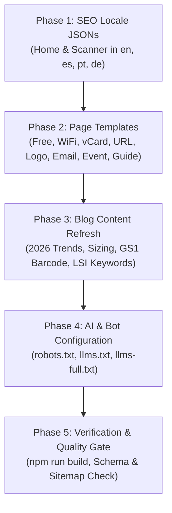

# 📋 Full Detailed Plan to Improve Keywords & SEO/GEO Performance
**Platform:** [GenerateCustomQR](https://generatecustomqr.com)  
**Target:** 2026 Search Rankings, AI Answer Engines (Claude-SearchBot, Perplexity, ChatGPT-User, Google AI Overviews, Apple Intelligence)

---

## 🧭 Executive Summary of the Plan

Based on the master keyword research in [`IMPORTANT/keyword_master_strategy.md`](file:///f:/Project%20001/qr%20code%20generator%206/IMPORTANT/keyword_master_strategy.md) and our deep audit in [`IMPORTANT/current_keywords_audit.md`](file:///f:/Project%20001/qr%20code%20generator%206/IMPORTANT/current_keywords_audit.md), this implementation plan executes 5 focused phases to upgrade all keyword surfaces across the entire application without disrupting existing rankings or URL structures.



---

## 🛠️ Phase-by-Phase Execution Plan

### 📌 Phase 1: Global SEO Locale Files (`frontend/src/i18n/seo/`)
* **Files:** `en.json`, `es.json`, `pt.json`, `de.json`
* **Actions:**
  1. **English (`en.json`):**
     - Enhance `home.keywords` with `custom qr code generator, free qr code with logo, aesthetic qr code generator, vector svg qr code, 300 dpi printable qr, client-side private qr maker`.
     - Update `scanner.title` to `Free QR Code Scanner Online — Scan Camera & Image (No App)`.
     - Update `scanner.keywords` to include `scan qr code on pc laptop mac, paste screenshot qr code ctrl v, online qr decoder free`.
  2. **Spanish (`es.json`):**
     - Enrich with `generador de codigos qr gratis, crear codigo qr con logo, escanear codigo qr online sin app, leer qr con camara pc`.
  3. **Portuguese (`pt.json`):**
     - Enrich with `gerador de qr code gratis, criar qr code com logo, ler qr code online pc, leitor qr code pela camera`.
  4. **German (`de.json`):**
     - Enrich with `qr code generator kostenlos, qr code erstellen mit logo, qr code scanner online kostenlos, qr code scannen pc`.

---

### 📌 Phase 2: Page Templates Keyword & Meta Optimization (`frontend/src/page-templates/`)
* **Files:** `FreeGenPage.astro`, `WifiQrPage.astro`, `VCardQrPage.astro`, `UrlQrPage.astro`, `LogoQrPage.astro`, `EmailQrPage.astro`, `EventQrPage.astro`, `HowToUsePage.astro`, `AboutPage.astro`, `ContactPage.astro`, `PrivacyPage.astro`, `TermsPage.astro`
* **Actions:**
  1. **`FreeGenPage.astro`:**
     - Update keywords: `free qr code generator no watermark, free qr code generator no paywall, free static qr code generator, free qr code commercial use, qr code generator no signup`.
     - Update copy to state `40+ dot styles, 51 text frames, 121 templates`.
  2. **`WifiQrPage.astro`:**
     - Update keywords: `wifi qr code generator, wpa3 wifi qr code, connect to wifi without password, guest wifi qr code printable, scan to connect wifi, hotel wifi qr code`.
  3. **`VCardQrPage.astro`:**
     - Update keywords: `vcard qr code generator, vcard 3.0 qr code, digital business card qr code free, electronic business card qr code, iphone contact qr code, save contact qr code free`.
  4. **`UrlQrPage.astro`:**
     - Update title to `URL to QR Code Generator — Convert Links Free (No Watermark)`.
     - Update keywords: `url to qr code, link to qr code generator, website link qr code no watermark, convert link to qr code free, utm campaign tracking qr code`.
  5. **`LogoQrPage.astro`:**
     - Update keywords: `qr code with logo, qr code logo generator, custom branded qr code generator, transparent background logo qr code, qr code with company logo free, add logo to qr code`.
  6. **`EmailQrPage.astro`:**
     - Update keywords: `email qr code generator, mailto qr code generator, pre-filled email qr code, customer support email qr code, feedback form email qr code`.
  7. **`EventQrPage.astro`:**
     - Update title to `Free Event QR Code Generator — 1-Tap Add to Calendar`.
     - Update keywords: `event qr code generator, calendar qr code generator free, ical event qr code maker, wedding invitation qr code, add to calendar qr code`.
  8. **`HowToUsePage.astro`:**
     - Update keywords: `how to make a qr code, qr code best practices design and print, qr error correction levels explained, minimum print size for qr code, step by step qr code guide`.

---

### 📌 Phase 3: Blog Posts Keyword Refresh & Year Update (`frontend/src/content/blog/`)
* **Files:** `qr-code-trends-2025.md` (+ localized `es/`, `pt/`, `de/`), and other 11 blog markdown files.
* **Actions:**
  1. **Update Trends Article:**
     - Refresh title: `QR Code Trends 2026: GS1 Sunrise 2027, AI Design & Security Shift`.
     - Update keywords: `qr code trends 2026, future of qr codes, 2d barcode transition gs1 sunrise 2027, eu digital product passport qr code, qr code adoption statistics`.
     - Update body copy to cover GS1 Sunrise 2027 and EU DPP mandates.
  2. **Enrich Frontmatter Keywords in Existing 11 Articles:**
     - Align keywords with the LSI entities and PAA questions identified in [keyword_master_strategy.md](file:///f:/Project%20001/qr%20code%20generator%206/IMPORTANT/keyword_master_strategy.md).

---

### 📌 Phase 4: AI & Answer Engine Optimization (`frontend/public/`)
* **Files:** `robots.txt`, `llms.txt`, `llms-full.txt`
* **Actions:**
  1. **`robots.txt`:**
     - Add explicit allowance for `Claude-SearchBot` and `ChatGPT-User`:
       ```txt
       User-agent: Claude-SearchBot
       Allow: /
       Disallow: /api/

       User-agent: ChatGPT-User
       Allow: /
       Disallow: /api/
       ```
  2. **`llms.txt` & `llms-full.txt`:**
     - Update feature inventory to reflect **40+ dot styles, 51 text frames, 121 templates, WPA3 WiFi, vCard 3.0, Level H error recovery, 300 DPI PDF/SVG export, and zero-server-logging privacy architecture**.

---

### 📌 Phase 5: Verification & Quality Assurance
* **Actions:**
  1. Run `npm run build` in `frontend` to verify 0 syntax or layout compilation errors.
  2. Verify meta tags and schemas in rendered HTML.
  3. Validate canonical links, sitemaps, and hreflang tags across all 4 locales.
