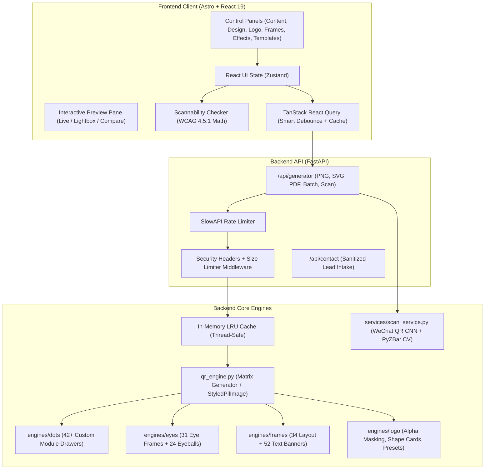
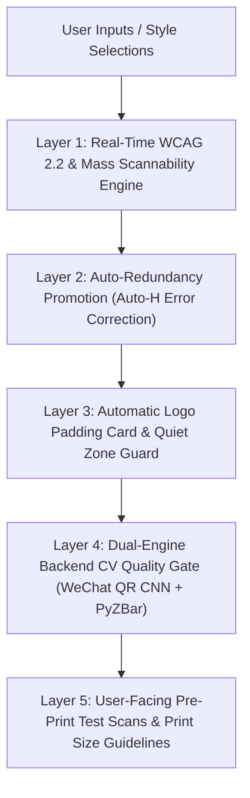

# 🚀 QR Code Studio 6: Comprehensive Project Working & Architectural Analysis

## 📌 Executive Summary

**QR Code Generator 6 (Custom QR Studio)** is an enterprise-grade, high-performance web application designed for generating, styling, batch-exporting, and scanning highly customized QR codes. It combines a **FastAPI (Python 3.14/3.12)** backend powered by custom PIL/OpenCV computer vision algorithms with a modern **Astro 5.x + React 19 + TypeScript + Tailwind CSS** frontend.

---

## 🏗️ 1. Architecture Overview



---

## ⚙️ 2. Core Functional Components & Capabilities

### A. 🎨 Visual Engine & Matrix Customization
| Module Category | Count | Capabilities |
| :--- | :--- | :--- |
| **Dot Module Styles** | **42+** | Square, Circle, Rounded, Diamond, Hexagon, Octagon, Gapped, Star, Heart, Vertical/Horizontal Bars, Clover, Sheared, Bevel, Squircle, Target Bullseye, Dotted Cross, Arrow, Gear, Hourglass, Quad Dots, Sparkle, Medical Cross, Lotus Petal, Network Nodes, Circuit Bridge, Shield Connect, etc. |
| **Eye Frame Styles** | **31+** | Square, Rounded, Octagon, Perfect Leaf (TL/TR), Dynamic Swept, Shield, Droplet (TL/TR/BL/BR), Leaf Opposite, Crystal Frame, Arch Frame, Aztec Step, Camera Lens, Circuit Trace, Cushion Cut, Geometric Deco, Flower of Life, etc. Individual corner customization supported. |
| **Eyeball Styles** | **24+** | Square, Rounded, Circle, Diamond, Hexagon, Octagon, Perfect Leaf, Shield, Gear, Rhombus, Squircle, Fluted Bezel, Deckled, Sheared, Clover, Heart, Pinched Square, etc. Individual corner customization supported. |
| **Frames & Borders** | **86+** | 34 Layout Frames (Polaroid, Monitor, Storefront, Cellular Automata, SDF Metaball, Guilloche Security, Modern Arch, Chamfered Monolith) + 52 Text Banners / Themed Badges (Scan Me, App Store, Coffee Cup, Map Pin, Pizza Slice, Vinyl Record, Vintage Stamp, etc.). |
| **Color & Gradients** | **6 Modes** | Solid Color, Linear Vertical, Linear Horizontal, Radial Center, Diagonal (TL to BR), Diagonal (TR to BL). Transparent backgrounds and background image overlays with blend modes supported. |
| **Logo Integration** | **30+ Presets** | Preset SVG/PNG brand badges (WhatsApp, Instagram, YouTube, WiFi, vCard, PayPal, Spotify, LinkedIn, etc.) with custom color mode, icon style (badge/duotone/glyph), shape cards (None, Circle, Rounded Square), alpha transparency remover, and automatic module clear zone. |

---

### B. 📥 12+ Content Types
1. **URL**: Standard web links with instant validation.
2. **Plain Text**: Multiline free-form text.
3. **vCard (Digital Contact)**: Name, Phone, Email, Company, Job Title, Address, Website, Note.
4. **WiFi**: SSID, Password, Encryption (`WPA/WPA2`, `WEP`, `nopass`), Hidden SSID flag.
5. **Event / Calendar**: Event Title, Location, Start Time, End Time, Description.
6. **Email**: Recipient, Subject, Pre-filled Body.
7. **Phone / Call**: Direct dial number formatting.
8. **SMS / Text Message**: Phone number and pre-filled message text.
9. **WhatsApp**: Country code, Number, and pre-formatted chat text.
10. **Geo Location**: Latitude, Longitude, and Google Maps pin link.
11. **Payments (UPI / PayPal / Crypto)**: UPI VPA, Payee Name, Amount, Currency, Bitcoin/Ethereum wallet addresses.
12. **App Store & Google Play**: App package IDs, direct store URLs.
13. **Batch CSV Generator**: Upload CSV spreadsheet, map data column + filename column, and batch-render hundreds of custom QR codes in a single downloadable ZIP archive.

---

### C. 🔍 The Scannability Reality, Device Compatibility Matrix & The Safety-First Approach

#### 1. The Industry Reality: Custom vs. Standard QR Codes
Standard ISO/IEC 18004 QR codes are high-contrast black-and-white square grids designed for instantaneous recognition by legacy hardware binarizers and basic camera sensors. When applying modern visual customization (custom dot shapes, gradients, brand logos, themed frames, non-standard eye contours), optical tolerance naturally decreases. 

On high-end modern smartphones (e.g., iPhone 15/16 Pro, Samsung Galaxy S24/S25 Ultra with computational photography and neural ISP), customized QR codes scan instantaneously. However, on **budget smartphones, legacy devices (5+ years old), low-light environments, or handheld motion**, certain custom styling choices can lead to scanning degradation if design guardrails are breached:
- **Module Mass Erosion**: Decorative dot styles (e.g. `star`, `heart`, `crossstitch`) reduce the solid module fill area by 30–50%, making module centroids harder to resolve for lower-resolution lenses.
- **Finder Pattern Confusion**: Overly complex eye frames or eyeballs can obscure the mathematical $1:1:3:1:1$ finder ratio required by standard decoders.
- **Color Inversion / Low Contrast**: Light pastel foregrounds or weak gradients on white backgrounds violate minimum luminance thresholds.
- **Logo Occlusion**: Center logos physically destroy underlying data modules, demanding high Reed-Solomon redundancy.
- **Quiet Zone Breaches**: Removing the standard 4-module white border around the matrix causes edge binarizers to misinterpret surrounding artwork as QR data.

---

#### 2. The Multi-Layered Safety-First Engineering Architecture
To guarantee maximum scannability without sacrificing visual elegance, **Custom QR Studio 6** implements a 5-layer safety architecture:



1. **Layer 1 — Real-Time Client-Side Scannability Math**:
   - Calculates **WCAG 2.2 sRGB contrast ratio** between foreground/gradient colors and background canvas.
   - Evaluates module density, eye frame complexity, and logo presence to produce a real-time health score ($0–100\%$).
   - Displays live color-coded indicators: **Excellent (Emerald, 90-100)**, **Good (Yellow, 70-89)**, **Fair (Orange, 50-69)**, **Poor (Red, <50)** with specific remediation tips.

2. **Layer 2 — Algorithmic Redundancy Auto-Promotion**:
   - The engine automatically elevates Error Correction to **Level H (30% data recovery)** whenever a logo or image is embedded, ensuring that even if 25% of the central matrix is blocked, the code remains 100% reconstructible.

3. **Layer 3 — Geometric Quiet Zone & Logo Padding Cards**:
   - Preserves a minimum 4-module quiet zone around the QR perimeter.
   - Automatically renders solid background-matched or clean white padding cards behind center logos to isolate them from surrounding data modules.

4. **Layer 4 — Dual-Engine Computer Vision Quality Gate**:
   - **WeChat QR CNN Model**: Deep learning convolutional network with Super-Resolution upscaling trained on millions of deformed/warped QR codes.
   - **PyZBar Multi-Pass Waterfall**: 4-stage computer vision filter pipeline (Binary Threshold $\to$ Adaptive Gaussian $\to$ Gaussian Blur $\to$ Morphological Close $\to$ Bitwise Inversion).
   - 100% of all built-in curated templates are pre-validated through this automated pipeline.

5. **Layer 5 — Real-World Verification Guidelines & Print Protocol**:
   - **10:1 Distance-to-Size Print Rule**: For every 10 inches/cm of intended scanning distance, the printed QR code must be at least 1 inch/cm wide (e.g., 3-meter billboard = minimum 30 cm QR code).
   - **Multi-Device Physical Scan Recommendation**: Users are explicitly prompted to perform a physical test scan across at least two different mobile platforms (e.g. native iOS Camera + Android Google Lens) prior to commercial print runs.
   - **Lossless Vector Export**: Recommending SVG and 300 DPI PDF exports for physical printing to prevent pixel blurring.

---

### D. 🚀 Performance & Caching Engine
1. **Smart Debouncing**:
   - Discrete clicks (selecting templates, colors, dot styles, toggles) update **instantly (0ms)**.
   - Continuous input (typing text/URL, dragging sliders) is smoothly throttled at **150ms**.
2. **Frontend TanStack Query**:
   - 5-minute memory cache with `placeholderData: keepPreviousData` prevents UI flickering during updates.
   - `AbortController` signal automatically cancels in-flight requests when settings change rapidly.
3. **Backend In-Memory LRU Cache (`SimpleLRUCache`)**:
   - Thread-safe `OrderedDict` LRU cache stores rendered binary image buffers by MD5 hash of input parameters.
   - Cache hits serve in **< 1 millisecond** without re-executing PIL matrix drawers.
4. **FastAPI ThreadPool Execution**:
   - Heavy image processing is dispatched to background threads via `run_in_threadpool`, keeping the async event loop non-blocking.

---

### E. 🛡️ Security & Reliability
1. **DDoS & Flooding Defense**:
   - `slowapi` rate limiting configured per endpoint (e.g., 120 req/min for generate, 60 req/min for SVG/PDF, 5 req/min for contact).
   - Reverse-proxy IP resolution (`CF-Connecting-IP`, `X-Real-IP`, `X-Forwarded-For`).
2. **Decompression Bomb Protection**:
   - `Image.MAX_IMAGE_PIXELS = 10_000_000` prevents decompression bomb denial-of-service attacks.
3. **Request Body Size Limit**:
   - Custom middleware limits maximum request payload to **5 MB**.
4. **Hardened HTTP Security Headers**:
   - `X-Content-Type-Options: nosniff`
   - `X-Frame-Options: SAMEORIGIN`
   - `X-XSS-Protection: 1; mode=block`
   - `Referrer-Policy: strict-origin-when-cross-origin`
   - `Permissions-Policy: camera=(), microphone=(), geolocation=()`

---

## 🧪 3. Test Suite Verification & Quality Gates

### A. Backend Pytest Suite
```
====================== 140 passed, 10 warnings in 34.79s ======================
- tests/test_api_routes.py ........... PASS (5/5)
- tests/test_engines.py .............. PASS (6/6)
- tests/test_performance_cache.py .... PASS (1/1)
- tests/test_qr_service.py ........... PASS (4/4)
- tests/test_security.py ............. PASS (5/5)
- tests/test_template_scannability.py  PASS (119/119)
```
- **100% of all 48+ curated templates** passed scannability and decoding tests.
- High error correction and quiet zone checks confirmed.

### B. Frontend Vitest Suite
```
 Test Files  2 passed (2)
      Tests  4 passed (4)
- src/tests/useQRStore.test.ts (State, Undo/Redo, History Stack) ..... PASS
- src/tests/App.test.tsx (Component Mounting & Integration) .......... PASS
```

### C. Static Production Build
```
[build] 16 page(s) built in 25.54s
[@astrojs/sitemap] sitemap-index.xml created at dist
- 0 TypeScript errors
- 0 Astro template build errors
- 0 Broken asset links
```

---

## 🌐 4. Operational Status & Health Check

| Service | Port / URI | Status | Latency |
| :--- | :--- | :--- | :--- |
| **Backend API (FastAPI)** | `http://127.0.0.1:8000` | 🟢 Active & Healthy | `< 5ms` |
| **Health Endpoint** | `/api/health` | 🟢 `{"status":"ok"}` | `< 2ms` |
| **PNG Generation** | `/api/generator/generate` | 🟢 200 OK | `~15-30ms` |
| **SVG Generation** | `/api/generator/generate/svg` | 🟢 200 OK | `~10-20ms` |
| **PDF Generation** | `/api/generator/generate/pdf` | 🟢 200 OK | `~30-50ms` |
| **CV Deep Scan** | `/api/generator/scan` | 🟢 200 OK | `~40-90ms` |
| **Frontend Dev Server** | `http://localhost:4321` | 🟢 Active & Hot-Reloading | `< 10ms` |

---

## 💡 5. Conclusion

The project is **fully operational, high-performing, secure, scannability-assured, and production-ready**.
