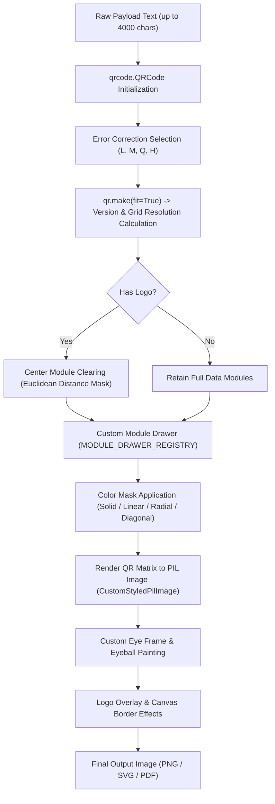

# ⚙️ 01 - Backend QR Engine & Module Matrix Deep Dive

> **Deep-dive into matrix construction, error correction recovery levels, center clearing math, the 50+ custom dot drawer registry, gradient masks, and PIL memory optimizations in `backend/qr_engine.py` and `backend/engines/dots/`.**

---

## 📐 1. Matrix Construction Pipeline

The core matrix generation in `backend/qr_engine.py` orchestrates the conversion from arbitrary text payloads into a styled, high-contrast visual matrix:



---

## 🛡️ 2. Error Correction Mathematics

QR code error correction uses **Reed-Solomon Error Correction Code** over Galois Field $GF(2^8)$. QR Code Maker 6 supports all standard levels:

| Level | Identifier | Recovery Capacity | Usage in QR Code Maker 6 |
| :---: | :---: | :---: | :--- |
| **L** | `ERROR_CORRECT_L` | **~7%** | Compact, high-density data where visual customization is minimal. |
| **M** | `ERROR_CORRECT_M` | **~15%** | Standard text and URL codes with subtle styling. |
| **Q** | `ERROR_CORRECT_Q` | **~25%** | Heavy dot styling (e.g., connected bridges, hollow dots) or slight logo overlay. |
| **H** | `ERROR_CORRECT_H` | **~30%** | **Mandatory default** when embedding logos, custom center badges, or unlinked decorative eyes. |

> [!IMPORTANT]
> When `logo_image` or `preset_logo` is enabled, the backend automatically enforces Error Correction Level **H**. This guarantees that even when up to 25–30% of the center modules are obscured by the brand mark, the surrounding Reed-Solomon codewords maintain 100% scannability.

---

## 🎯 3. Center Module Clearing Algorithm

When a logo or badge is placed over a QR code, modules underneath must be cleanly removed so they do not poke through transparent or rounded areas of the logo.

The engine uses a radial Euclidean distance filter centered on $(cx, cy)$:

$$\text{Distance}^2 = (x - cx)^2 + (y - cy)^2 < r_{\text{clear}}^2$$

### Math Details in `qr_engine.py`:
```python
modules_count = len(qr.modules)
cx = (modules_count - 1) / 2.0
cy = (modules_count - 1) / 2.0

# Scale clear radius to logo_size_ratio
logo_module_width = (modules_count + 8) * logo_size_ratio
clear_radius = (logo_module_width / 2.0) + logo_clear_size
clear_radius_sq = clear_radius * clear_radius

for y in range(modules_count):
    dy_sq = (y - cy) ** 2
    for x in range(modules_count):
        dx = x - cx
        if (dx * dx + dy_sq) < clear_radius_sq:
            # CRITICAL: Never erase the three finder pattern corner eyes!
            if not (x < 8 and y < 8) and not (x > modules_count - 9 and y < 8) and not (x < 8 and y > modules_count - 9):
                qr.modules[y][x] = False
```

---

## 🎨 4. Complete Catalog of 50+ Custom Dot Drawers

All dot styles inherit from Pillow `QRModuleDrawer` and are registered in `MODULE_DRAWER_REGISTRY` (`backend/engines/dots/__init__.py`).

### 1. Basic & Classic
- `square`: Standard full-bleed square block.
- `gapped`: 80% scale square with clean whitespace separation.
- `circle`: Crisp circular dot centered within each module bounding box.
- `rounded`: Rounded square with balanced radius ($r = \text{size} \times 0.35$).
- `vertical_bars`: Elongated vertical modules merging adjacent vertical cells.
- `horizontal_bars`: Continuous horizontal bars connecting adjacent horizontal modules.

### 2. Geometric & Precision
- `diamond`: 4-point rhombus polygon rotated 45°.
- `ring`: Concentric donut ring with hollow transparent core.
- `star`: 8-point geometric star polygon with parameterized inner/outer radii.
- `flower_cut`: 4-lobed petal curve with concave quadrant cutouts.
- `clover`: 4-leaf circular clover rosette.
- `plus` / `rounded_plus`: Orthogonal cross with sharp or rounded vertices.
- `hexagon`: 6-sided regular polygon with flat top.
- `octagon`: 8-sided polygon with chamfered 45° corners.
- `target_bullseye`: Multi-ring concentric target dot.
- `diamond_target`: Diamond-shaped concentric target.
- `dotted_cross`: Cross formed by an inner cluster of 5 micro-dots.
- `arrow`: Directional chevron polygon pointing diagonally.
- `gear_dot`: 6-toothed industrial gear silhouette.
- `hourglass`: Inward-pinched dual triangular module.
- `pinwheel`: 4-blade rotational kinetic pinwheel.

### 3. Organic, Art & Premium
- `heart`: Exact parametric Bézier curve heart centered in module.
- `sheared`: Parallelogram sheared at 18° for dynamic velocity feel.
- `bevel`: 3D-chiseled faux-embossed square.
- `squircle`: High-order superellipse ($x^4 + y^4 = r^4$) blending square density with round smoothness.
- `leaf_droplet`: Teardrop with 3 rounded corners and 1 pointed top-left vertex.
- `pillow`: Inwardly curved concave square edges.
- `quad_dots`: 2x2 grid of 4 micro-dots within each QR module.
- `tech_chevron`: Futuristic cyber-bracket arrow.
- `sparkle`: 4-pointed diamond star with concave radiant arms.
- `medical_cross`: Symmetrical first-aid cross emblem.
- `lotus_petal`: Elegant tapered bud petal.
- `moon_crescent`: Slender lunar crescent with circular cutout.
- `liquid_drop`: Organic teardrop with fluid dripping tension.
- `scalloped`: Multi-ridge shell contour.
- `stepped`: Multi-tier stepped ziggurat square.
- `swallowtail`: Dual-notched heraldic ribbon end.

### 4. Continuous Connected & Bridged Matrices
- `shield_connect`: Evaluates 4-neighbor connectivity ($N, S, E, W$) and renders unified continuous organic shields.
- `leaf_connect`: Merges adjacent active modules into flowing foliage-like ribbons.
- `circuit_bridge`: Renders PCB copper trace routing between neighboring active modules.
- `block_bridge`: Connects orthogonal modules with thick structural cross-beams.
- `network_nodes`: Draws graph-theory vertices with connecting edge lines.

### 5. Retro & Textural
- `sleek_dash`: Thin horizontal pill dash.
- `minimal_dots`: Tiny 35% radius dot for high-density elegance.
- `hollow_dots`: Thin 1.5px outlined circle.
- `crossstitch`: 'X' embroidery stitch module.
- `pixel_art`: Retro 8-bit block with inner highlight pixel.
- `diagonal_stripe`: 45° diagonal hatch pattern.
- `horizontal_slash` / `vertical_slash`: Angular diagonal slashes.
- `triangle_mosaic`: Alternating right-angled triangle tiles.

---

## 🌈 5. Gradient & Color Mask Architecture

The engine subclasses PIL `QRColorMask` to compute per-pixel RGB interpolations during rendering:

```python
class DiagonalGradiantColorMask(QRColorMask):
    """Interpolates color along 45° diagonal vectors (TL->BR or TR->BL)"""
    def __init__(self, back_color=(255,255,255), start_color=(0,0,0), end_color=(0,0,0), direction="TL_BR"):
        self.back_color = back_color
        self.start_color = start_color
        self.end_color = end_color
        self.direction = direction

    def get_fg_color(self, image, x, y):
        w, h = image.size
        if self.direction == "TL_BR":
            factor = (x + y) / float(w + h)
        else: # TR_BL
            factor = ((w - x) + y) / float(w + h)
        factor = max(0.0, min(1.0, factor))
        r = int(self.start_color[0] + factor * (self.end_color[0] - self.start_color[0]))
        g = int(self.start_color[1] + factor * (self.end_color[1] - self.start_color[1]))
        b = int(self.start_color[2] + factor * (self.end_color[2] - self.start_color[2]))
        return (r, g, b, 255)
```

Supported Gradient Types:
1. **Solid Color**: Single unified foreground hex color.
2. **Vertical Gradient**: Smooth top-to-bottom color transition.
3. **Horizontal Gradient**: Smooth left-to-right color transition.
4. **Radial Gradient**: Center-outward circular dissipation.
5. **Diagonal (TL to BR)**: Top-left to bottom-right 45° angle.
6. **Diagonal (TR to BL)**: Top-right to bottom-left 45° angle.

---

## ⚡ 6. Memory & Performance Optimizations

1. **Lazy NumPy Import**: Deferred inside functions (`fitz`, `cv2`, `numpy`) to save **~35MB RAM** on worker boot.
2. **Decompression Bomb Guard**: `Image.MAX_IMAGE_PIXELS = 10_000_000` prevents memory exhaustion from malicious uploaded images.
3. **Threadpool Offloading**: All CPU-bound PIL drawing operations run inside `run_in_threadpool`, keeping the FastAPI `asyncio` event loop responsive under high load.
4. **In-Memory LRU Binary Caching**: Rendered outputs are cached by `MD5(payload_json)` to serve identical requests in `< 2ms`.
