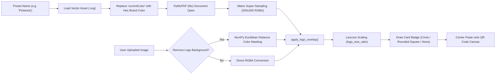

# 🏷️ 03 - Logo Processing & Vector Overlays Engine

> **Architectural breakdown of vector SVG rasterization with PyMuPDF, color-distance transparency removal with NumPy, badge card geometry, and dual client-server consistency in `backend/engines/logo/` and `frontend/src/components/previews/SvgIcons.tsx`.**

---

## 🚀 1. Vector Logo Pipeline Overview

QR Code Maker 6 embeds both user-uploaded raster images (PNG, JPG, WebP) and high-precision vector SVG preset logos into the QR center without losing crispness:



---

## 🎨 2. PyMuPDF (fitz) Vector Rasterization (`processor.py`)

Vector SVGs are rendered into high-resolution transparent pixmaps using PyMuPDF:

```python
def generate_preset_logo(name: str, color: tuple = (0, 0, 0)) -> Image.Image:
    asset_dir = os.path.abspath(os.path.join(os.path.dirname(__file__), "..", "..", "assets", "preset_logos"))
    svg_path = os.path.join(asset_dir, f"{name.lower()}.svg")
    
    if not os.path.exists(svg_path) or fitz is None:
        return None
        
    with open(svg_path, "r", encoding="utf-8") as f:
        svg_content = f.read()
        
    # Replace currentColor with desired brand or user hex color
    hex_color = "#{:02x}{:02x}{:02x}".format(*color)
    svg_content = svg_content.replace('currentColor', hex_color)
    
    doc = fitz.open("svg", svg_content.encode('utf-8'))
    page = doc[0]
    rect = page.rect
    svg_w = rect.width if rect.width > 0 else 24.0
    svg_h = rect.height if rect.height > 0 else 24.0
    
    # Scale exactly into 200x200 bounding box
    mat = fitz.Matrix(200.0 / svg_w, 200.0 / svg_h)
    pix = page.get_pixmap(matrix=mat, alpha=True)
    img = Image.frombytes("RGBA", [pix.width, pix.height], pix.samples)
    
    # Center into transparent 200x200 canvas
    out_img = Image.new("RGBA", (200, 200), (255, 255, 255, 0))
    offset = ((200 - img.width) // 2, (200 - img.height) // 2)
    out_img.paste(img, offset, img)
    return out_img
```

---

## 🪄 3. NumPy Euclidean Color Distance Transparency Removal

When user logos have unsightly white/black background boxes, the engine removes them cleanly:

$$\Delta E = \sqrt{(R - T_r)^2 + (G - T_g)^2 + (B - T_b)^2} \le \text{tolerance}$$

```python
def make_color_transparent(img: Image.Image, color_rgb: tuple, tolerance: int = 0) -> Image.Image:
    import numpy as np
    img = img.convert("RGBA")
    data = np.array(img)
    r, g, b, a = data.T
    tr, tg, tb = color_rgb
    
    # Calculate 3D Euclidean distance in RGB color space
    distance = np.sqrt(
        (r.astype(int) - tr) ** 2 + 
        (g.astype(int) - tg) ** 2 + 
        (b.astype(int) - tb) ** 2
    )
    transparent_mask = distance <= tolerance
    data[..., 3][transparent_mask.T] = 0 # Zero out alpha channel
    return Image.fromarray(data)
```

---

## 🛡️ 4. Badge Cards, Padding & Resizing

`apply_logo_overlay()` scales the logo relative to the total QR image dimension (`logo_size_ratio`, default `0.18`) using high-quality **Lanczos** anti-aliasing:

```python
basewidth = int(img.size[0] * logo_size_ratio)
wpercent = (basewidth / float(logo.size[0]))
hsize = int((float(logo.size[1]) * float(wpercent)))
logo = logo.resize((basewidth, hsize), Image.Resampling.LANCZOS)
```

### Card Badge Shapes:
1. **`None`**: Logo floats directly over cleared QR center.
2. **`Circle`**: Anti-aliased circular disk drawn with `card_draw.ellipse(card_box, fill=card_rgb)`.
3. **`Rounded Square`**: Continuous squircle card drawn with dynamic corner radius:
   $$\text{Radius} = \max(8, \text{int}(\min(card\_w, card\_h) \times 0.2))$$

---

## 🌐 5. Complete Catalog of 40+ Preset Brand Logos

All presets include official brand hex colors, category classifications, and search keywords:

| Category | Brand Logos Included | Brand Colors |
| :--- | :--- | :--- |
| **Social & Apps** | WhatsApp, Instagram, Facebook, YouTube, Pinterest, Snapchat, TikTok, X (Twitter), LinkedIn, Telegram, Spotify, Netflix, Twitch, Reddit, Discord, WeChat, Chat, Mobile App | `#25D366`, `#E4405F`, `#1877F2`, `#FF0000`, `#E60023`, `#FFFC00`, `#000000`, `#0A66C2`, `#24A1DE`, `#1DB954`, `#E50914`, `#9146FF`, `#FF4500`, `#5865F2`, `#07C160` |
| **Tech & Contact** | Link, Location, WiFi, VCard, Email, Phone, Scan QR, Calendar, Google Maps, Google Play, Gmail, Google Forms, Google Docs, ScanMe, PDF, GitHub | `#6D28D9`, `#DC2626`, `#0F766E`, `#1D4ED8`, `#D97706`, `#10B981`, `#EC4899`, `#0EA5E9`, `#4285F4`, `#3BCCFF`, `#EA4335`, `#7248B9`, `#F40F02`, `#181717` |
| **Business & Pay** | Shopping, Amazon, PayPal, Payment (Card), Storefront, Coffee, Yelp | `#8B5CF6`, `#FF9900`, `#003087`, `#34D399`, `#F97316`, `#D97706`, `#FF1A1A` |
| **Media & More** | Music, Vimeo, Globe, Heart, Star | `#06B6D4`, `#1AB7EA`, `#3B82F6`, `#F43F5E`, `#F59E0B` |

---

## ⚡ 6. Dual Client-Server Consistency

To maintain zero layout shifts between the React live browser preview and server-rendered downloads:
1. **Client-side (`getReactLogoPngDataUrl`)**: Renders exact SVG string paths onto an offscreen HTML5 `<canvas>` (size 400x400), applies the selected visual mode (`badge`, `duotone`, `glyph`), and caches the resulting Base64 Data URL.
2. **Server-side (`processor.py`)**: Renders the identical SVG file via PyMuPDF C-engine at matching coordinates and aspect ratios.
