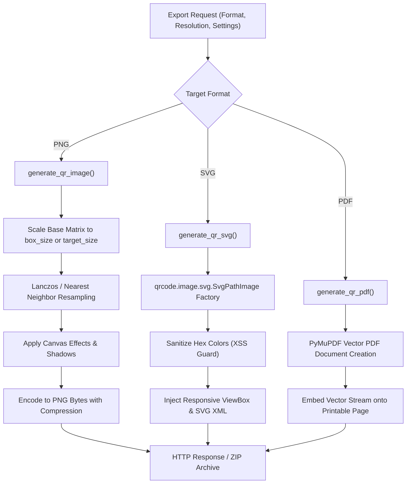

# 📦 05 - Batch Processing & High-Resolution Export Pipelines

> **Comprehensive breakdown of the multi-format rendering engine (PNG, SVG, PDF up to 8K), aspect ratio preservation math, CSV batch ingestion & ZIP streaming, and thread-safe LRU caching in `backend/services/qr_service.py` and `backend/routers/generator.py`.**

---

## 📐 1. High-Resolution Output Engine

QR Code Maker 6 exports production-ready QR codes across three industrial formats:



---

## 🖼️ 2. Resolution Scaling & Aspect Ratio Preservation

### Integer Box Scaling vs. Target Size:
When a user requests a specific target resolution (e.g. `2048px` for 2K or `4096px` for 4K):
1. **Unconstrained Mode (`no_stretching: false`)**: The engine scales the final composite image directly to `(target_size, target_size)` via Lanczos anti-aliasing.
2. **Aspect Ratio Preservation (`no_stretching: true`)**: The engine calculates integer module sizing:
   $$\text{box\_size} = \max\left(1, \left\lfloor \frac{\text{target\_size}}{\text{modules\_count} + 2 \times \text{quiet\_zone}} \right\rfloor\right)$$
   This prevents sub-pixel interpolation artifacts where black and white modules blur along module boundaries.

---

## 📄 3. Vector SVG Pipeline & Security Sanitization

In `backend/qr_engine.py`, raw vector SVG QR codes are generated directly from the mathematical matrix:

```python
def generate_svg_qr(data, fill_color="#000000", back_color="#ffffff", box_size=30, bg_transparent=False, error_correction="H", quiet_zone=4, canvas_radius=0):
    factory = qrcode.image.svg.SvgPathImage
    qr = qrcode.QRCode(
        error_correction=ec_level,
        box_size=box_size,
        border=quiet_zone,
        image_factory=factory
    )
    qr.add_data(data)
    qr.make(fit=True)
    img = qr.make_image()
    svg_str = img.to_string().decode('utf-8')
    
    # Responsive container styles
    svg_str = re.sub(r'width="[^"]+"', 'width="100%"', svg_str, count=1)
    svg_str = re.sub(r'height="[^"]+"', 'height="100%"', svg_str, count=1)
    
    # XSS Security Sanitization
    safe_fill = sanitize_svg_color(fill_color, "#000000")
    safe_back = sanitize_svg_color(back_color, "#ffffff")
    svg_str = svg_str.replace("fill:#000000", f"fill:{safe_fill}")
    
    return svg_str.encode('utf-8')
```

### XSS Prevention in SVG:
To prevent SVG script injection attacks, `sanitize_svg_color` validates all input color strings with strict regex (`^#[0-9a-fA-F]{3,8}$` or `rgba?\(...\)` or approved CSS color names).

---

## 🗄️ 4. CSV Batch Processing & ZIP Streaming (`/generate/batch`)

The batch processor allows enterprise users to generate dozens of personalized QR codes simultaneously from a spreadsheet:

1. **Client Ingestion**: The user uploads a `.csv` file. The frontend parses headers with PapaParse, letting the user choose which column contains the QR payload data and which contains the output filenames.
2. **Payload Dispatch**: Dispatches a `BatchQRRequest` containing up to 50 items with unified design settings.
3. **In-Memory Streaming**: Uses Python's `zipfile.ZipFile` in memory (`io.BytesIO`) without creating temporary disk files:

```python
def process_batch():
    with zipfile.ZipFile(zip_buffer, "a", zipfile.ZIP_DEFLATED, False) as zip_file:
        for idx, item in enumerate(payload.items):
            base_name = sanitize_filename(item.filename) if item.filename else f"QR_Item_{idx+1:03d}"
            ext = payload.format.lower()
            file_name = f"{base_name}.{ext}"
            
            if ext == "svg":
                svg_bytes = generate_qr_svg(item.data, payload.settings)
                zip_file.writestr(file_name, svg_bytes)
            elif ext == "pdf":
                pdf_io = generate_qr_pdf(item.data, payload.settings)
                zip_file.writestr(file_name, pdf_io.getvalue())
            else:
                png_io = generate_qr_image(item.data, payload.settings)
                zip_file.writestr(file_name, png_io.getvalue())
    zip_buffer.seek(0)
    return zip_buffer
```

4. **Filename Sanitization**: `sanitize_filename` strips illegal path traversal characters (`\ / * ? : " < > | ..`) and clamps length to 64 characters.

---

## 🚀 5. Performance Caching Architecture (`SimpleLRUCache`)

To ensure near-instantaneous response times, `backend/services/qr_service.py` maintains thread-safe in-memory LRU caches for generated binaries:

```python
class SimpleLRUCache:
    def __init__(self, maxsize: int = 1024):
        self.maxsize = maxsize
        self.cache = OrderedDict()
        self.lock = threading.Lock()

    def get(self, key: str):
        with self.lock:
            if key in self.cache:
                self.cache.move_to_end(key)
                return self.cache[key]
            return None

    def set(self, key: str, value: bytes):
        with self.lock:
            if key in self.cache:
                self.cache.move_to_end(key)
            self.cache[key] = value
            if len(self.cache) > self.maxsize:
                self.cache.popitem(last=False)
```

### Cache Key Hashing:
`_compute_cache_key` creates an MD5 digest over a canonically sorted JSON representation of the text payload and all visual parameters. Identical requests return directly from memory in **`< 1.5ms`**.
