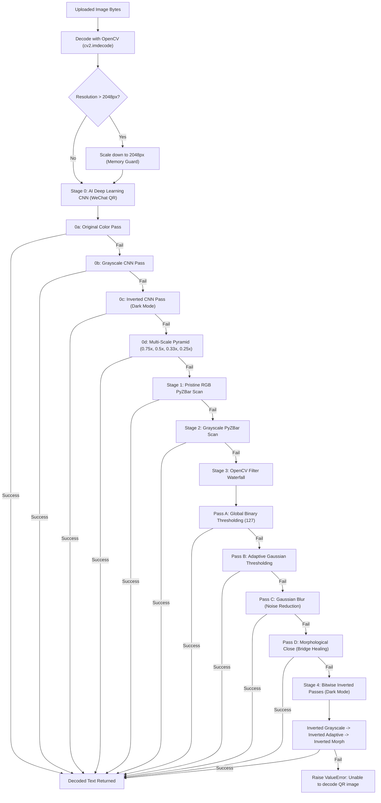

# 🔬 06 - Computer Vision Scanner & Scannability Quality Assurance

> **Deep-dive into the AI CNN WeChat QR scanner, OpenCV + PyZBar waterfall filter pipeline, dark-mode inversion filters, and empirical scannability verification protocols in `backend/services/scan_service.py` and `.agents/skills/qr-tester/`.**

---

## 👁️ 1. Computer Vision Scanner Architecture (`deep_scan_qr`)

`backend/services/scan_service.py` implements a **multi-stage waterfall pipeline** designed to stubbornly decode damaged, low-contrast, heavily stylized, inverted, or blurred QR codes that defeat standard decoders:



---

## 🤖 2. Stage 0: AI Deep Learning CNN (WeChat QR Detector)

The scanner incorporates OpenCV's **WeChat QR Caffe Model**, trained on millions of real-world deformed and stylized barcodes:

- **Detection Network (`detect.prototxt` + `detect.caffemodel`)**: Deep Convolutional Neural Network that predicts spatial bounding boxes and quad vertices even under heavy geometric skew and perspective distortion.
- **Super-Resolution Network (`sr.prototxt` + `sr.caffemodel`)**: Upscales and sharpens low-resolution or blurred module grids before decoding.

```python
wechat_detector = cv2.wechat_qrcode_WeChatQRCode(
    detect_prototxt, detect_caffe, sr_prototxt, sr_caffe
)
res, points = wechat_detector.detectAndDecode(img)
```

---

## 🧮 3. OpenCV Filter Waterfall Mechanics

If the CNN is not loaded or encounters an extreme edge case, the engine executes four distinct mathematical filters:

### 1. Global Thresholding (`Pass A`)
$$\text{dst}(x, y) = \begin{cases} 255 & \text{if } \text{src}(x, y) > 127 \\ 0 & \text{otherwise} \end{cases}$$

### 2. Adaptive Gaussian Thresholding (`Pass B`)
Calculates threshold values individually for each $11 \times 11$ neighborhood using a Gaussian-weighted sum minus constant $C=2$. Essential for decoding QR codes with **linear or radial gradients**.

### 3. Gaussian Blur (`Pass C`)
$$G(x, y) = \frac{1}{2\pi\sigma^2} e^{-\frac{x^2+y^2}{2\sigma^2}}$$
Convolves a $5 \times 5$ kernel to smooth high-frequency visual noise (such as artistic dot textures like `star`, `heart`, or `crossstitch`) back into solid module centroids.

### 4. Morphological Close (`Pass D`)
$$\text{dst} = (\text{src} \oplus B) \ominus B$$
Dilation followed by erosion using a $3 \times 3$ structuring element. Bridges microscopic gaps in discontinuous dot patterns (`gapped`, `minimal_dots`, `hollow_dots`, `circuit_bridge`) to re-establish clean topological module connectivity.

---

## 🛡️ 4. Mandatory Scannability Quality Gates

To guarantee that all generated designs can be read by any physical smartphone camera:

1. **4.5:1 Minimum Contrast Ratio**: The luminance contrast between the foreground modules ($L_1$) and background canvas ($L_2$) must satisfy:
   $$\text{Contrast Ratio} = \frac{L_1 + 0.05}{L_2 + 0.05} \ge 4.5$$
2. **Quiet Zone Integrity**: A border of at least 4 modules width must surround the matrix without visual clutter.
3. **Safe Logo Area**: Center logos must not exceed **20–25%** of the QR code area, and must always be paired with Error Correction Level **H** (30% recovery).
4. **Finder Pattern Preservation**: The three corner finder eyes (7x7 outer frame, 1-module separation, 3x3 eyeball) must maintain distinct, high-contrast separation from the internal data modules.
