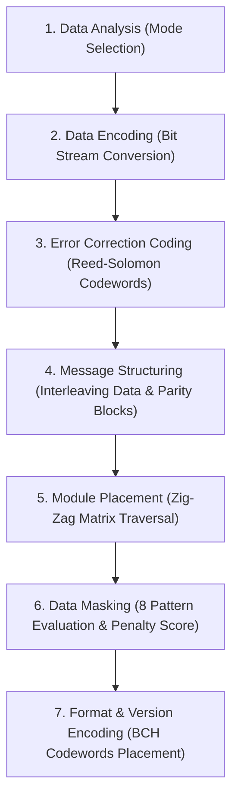

# 📜 07 - QR Code Standards, Symbology & ISO/IEC 18004 Specification

> **Formal reference for the QR code standard (ISO/IEC 18004:2024), version scaling (1–40), encoding modes, Reed-Solomon polynomial math, data masking penalty evaluations, and symbology anatomy.**

---

## 1. Overview

A **QR (Quick Response) code** is a two-dimensional matrix barcode that stores data as a pattern of black and white square modules. Unlike 1D barcodes, it encodes data both horizontally and vertically, giving it significantly higher data density. It includes built-in Reed-Solomon error correction so it can still be read even if part of the code is damaged, dirty, or obscured.

---

## 2. History & Standardization Timeline

| Year | Milestone |
| :--- | :--- |
| **1994** | Invented by **Denso Wave** (a Toyota group company) for tracking automotive components on manufacturing assembly lines. |
| **1997** | First formal industry standard published by AIM (Automatic Identification and Mobility), AIM ITS/97-001. |
| **1999** | Registered as Japanese Industrial Standard **JIS-X0510**. |
| **2000** | Adopted as a full ISO/IEC international standard: **ISO/IEC 18004:2000**. |
| **2000** | Adopted by Chinese National Standard (**GB/T 18284**). |
| **2002** | Adopted by Korean National Standards (**KS X ISO/IEC 18004**). |
| **2006** | Revised standard: **ISO/IEC 18004:2006** ("QR Code 2005"). |
| **2008** | iQR Code variant introduced by Denso Wave (rectangular high-density matrices). |
| **2015** | Revised standard: **ISO/IEC 18004:2015**. |
| **2024** | Latest international revision: **ISO/IEC 18004:2024**. |

> [!NOTE]
> Denso Wave released the QR code specification royalty-free, making it the universal standard worldwide. Every revision since 2000 has preserved strict backward compatibility: a code generated under the 2000 specification will scan seamlessly against decoders built to the 2024 spec.

---

## 3. Anatomy of a QR Code Symbol

A valid QR code symbol is composed of the following structural elements:

```
┌────────────────────────────────────────────────────────┐
│ [FINDER TL]   [TIMING HORIZONTAL]         [FINDER TR]  │
│  ███████      ▀ ▄ ▀ ▄ ▀ ▄ ▀ ▄ ▀ ▄          ███████     │
│  █ ▄▄▄ █                                   █ ▄▄▄ █     │
│  █ █ █ █      [FORMAT INFO]                █ █ █ █     │
│  █ ▀▀▀ █                                   █ ▀▀▀ █     │
│  ███████                                   ███████     │
│                                                        │
│  [TIMING VERTICAL]   [DATA & ERROR CODEWORDS]          │
│   █                                                    │
│   ▄                  [ALIGNMENT PATTERN]               │
│   █                       █████                        │
│   ▄                       █ ▄ █                        │
│   █                       █████                        │
│                                                        │
│ [FINDER BL]                                            │
│  ███████                                               │
│  █ ▄▄▄ █      [FORMAT INFO]                            │
│  █ █ █ █                                               │
│  █ ▀▀▀ █                                               │
│  ███████                                               │
└────────────────────────────────────────────────────────┘
  ▲
  └── 4-Module Minimum Quiet Zone
```

1. **Finder Patterns (Position Detection Patterns)**: Three identical $7 \times 7$ nested squares in the Top-Left, Top-Right, and Bottom-Left corners. They allow scanners to identify symbol presence, bounding box, and orientation across 360° of rotation.
2. **Separators**: A 1-module-wide white border isolating finder patterns from the data matrix.
3. **Timing Patterns**: Alternating black and white module lines connecting the three finder patterns horizontally and vertically, defining coordinate grid pitches even under slight physical warping.
4. **Alignment Patterns**: Smaller $5 \times 5$ concentric sub-patterns (present in Versions 2–40) placed at predefined matrix grid coordinates to correct spatial perspective distortion when scanned at oblique angles.
5. **Quiet Zone**: Mandatory blank margin (minimum **4 modules** wide) surrounding the entire symbol boundary, required for edge detection.
6. **Format Information**: 15 bits of data encoding the Error Correction Level (2 bits), Mask Pattern identifier (3 bits), and 10 error-correction bits generated via BCH $(15, 5)$ code.
7. **Version Information**: 18 bits encoding the symbol version number (present in Versions 7 through 40), protected by BCH $(18, 6)$ Golay code.
8. **Data and Error Correction Codewords**: Payload bytes interleaved with Reed-Solomon redundancy blocks filling all remaining matrix cells in a zig-zag column arrangement.

---

## 4. Versions & Dimension Scaling

QR codes are defined across **40 Versions**, where each incremental version increases matrix dimension by **+4 modules per side**:

$$\text{Dimension (modules)} = 17 + (4 \times \text{Version})$$

- **Version 1**: $21 \times 21$ modules
- **Version 2**: $25 \times 25$ modules
- **Version 5**: $37 \times 37$ modules
- **Version 10**: $57 \times 57$ modules
- **Version 20**: $97 \times 97$ modules
- **Version 40**: $177 \times 177$ modules (Max capacity)

---

## 5. Reed-Solomon Error Correction Levels

Error correction calculates redundant parity blocks using Reed-Solomon polynomials over the Galois Field $GF(2^8)$:

| Level | Identifier | Recovery Capacity | Intended Usage |
| :---: | :---: | :---: | :--- |
| **L** | Low | **~7%** | Clean environments, maximum density requirements. |
| **M** | Medium | **~15%** | Standard text and URL codes (default). |
| **Q** | Quartile | **~25%** | Moderate styling, outdoor poster wear. |
| **H** | High | **~30%** | **Center logo embedding**, custom frames, high-wear industrial use. |

---

## 6. Encoding Modes & Character Capacities

QR codes support four primary encoding modes, with dynamic mode-switching within a single payload:

| Mode | Mode Indicator | Allowed Characters | Bit Packing Density | Max Capacity (V40-L) |
| :--- | :---: | :--- | :---: | :---: |
| **Numeric** | `0001` | Digits `0–9` | 3 digits per 10 bits | **7,089** characters |
| **Alphanumeric** | `0010` | `0–9`, `A–Z`, space, `$ % * + - . / :` | 2 characters per 11 bits | **4,296** characters |
| **Byte (8-bit)** | `0100` | Full ISO-8859-1 / UTF-8 binary stream | 8 bits per character | **2,953** bytes |
| **Kanji** | `1000` | Shift JIS double-byte characters | 13 bits per character | **1,817** characters |

---

## 7. The 7-Step QR Generation Pipeline



1. **Data Analysis**: Evaluates input text to determine optimal mode segments (Numeric, Alphanumeric, Byte, or mixed).
2. **Data Encoding**: Generates binary bitstream prepended with 4-bit Mode Indicator and Character Count Indicator, padded with `11101100` and `00010001` bytes.
3. **Error Correction Coding**: Divides the data bitstream into discrete blocks and calculates generator polynomial remainder codewords.
4. **Structure Final Message**: Interleaves data blocks and error correction blocks to distribute burst damage evenly across the symbol.
5. **Module Placement**: Traverses the grid in 2-module-wide zig-zag columns from bottom-right to top-left, skipping reserved zones (finder, timing, alignment).
6. **Data Masking**: Inverts data bits using each of the 8 standard masking formulas (e.g., $(i+j) \bmod 2 = 0$, $i \bmod 2 = 0$, $(i \times j) \bmod 2 + (i \times j) \bmod 3 = 0$) and selects the mask that minimizes visual penalty points (preventing false finder patterns or large monolithic monochromatic clusters).
7. **Format & Version Placement**: Writes the 15-bit format sequence and (for $V \ge 7$) the 18-bit version string into reserved modules adjacent to the finder eyes.

---

## 8. Practical Guidelines for Custom QR Generators

1. **Contrast is King**: Scanners measure luminance deltas ($\Delta L \ge 4.5:1$). Dark foreground on a bright canvas is always more reliable than light-on-dark.
2. **Physical Print Threshold**: Minimum recommended physical print size is **$20 \times 20\text{ mm}$** ($0.8 \times 0.8\text{ in}$); on digital screens, minimum **$100 \times 100\text{ px}$**.
3. **Logo Area Rules**: Keep center logos under **20–25%** of total area, always paired with Error Correction Level **H**, and never encroach on the 3 corner finder patterns or timing tracks.
4. **Quiet Zone Inviolability**: Do not let decorative styling, text banners, or custom background textures eat into the 4-module quiet zone.
5. **Multi-Engine Empirical Validation**: Always test outputs across multiple distinct computer vision libraries and smartphone cameras (iOS Camera, Android Google Lens, OpenCV, PyZBar).

---

## 9. Normative References

- **ISO/IEC 18004:2024** — *Information technology — Automatic identification and data capture techniques — QR code bar code symbology specification*.
- **AIM ITS/97-001** (1997) — *Automatic Identification and Mobility Industry Standard*.
- **JIS X0510** (1999, 2004) — *Japanese Industrial Standard for Two-Dimensional Symbology — QR Code*.
