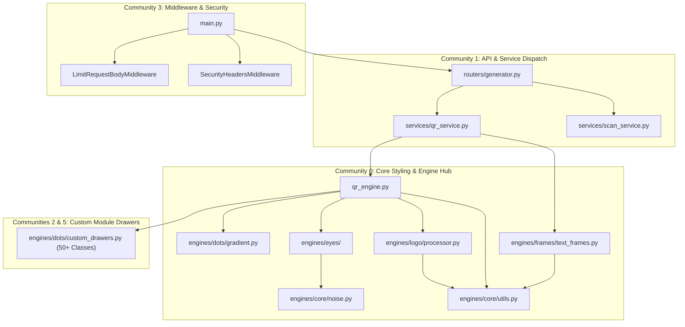

# 🕸️ 08 - Codebase Graph Topology & Dependency Analysis (Graphify)

> **Architectural dependency mapping, call graph centrality analysis, node degree distributions, community clustering, and cycle detection derived from Graphify AST and semantic analysis (`graphify-out/`).**

---

## 📊 1. Codebase Graph Summary & Metrics

According to the Graphify static analysis report (`graphify-out/GRAPH_REPORT.md`), the codebase exhibits a clean, modular graph structure:

```
┌─────────────────────────────────────────────────────────────────────────────┐
│                          Graphify Codebase Metrics                          │
├─────────────────────────────────────────────────────────────────────────────┤
│  • Total Graph Nodes:        279 structural AST nodes                        │
│  • Total Directed Edges:     535 invocation and data dependency edges       │
│  • Network Communities:      44 discrete functional clusters (12 primary)   │
│  • Graph Extraction Ratio:   98% EXTRACTED / 2% INFERRED / 0% AMBIGUOUS     │
│  • Circular Import Cycles:   0 (Zero import cycles detected across stack)   │
└─────────────────────────────────────────────────────────────────────────────┘
```



---

## 👑 2. "God Nodes" (Core Abstraction Centrality)

Graph centrality analysis identifies the 10 most interconnected functions and classes in the codebase (the core architectural hubs):

| Rank | Symbol / Abstraction | Source File | Edge Degree | Architectural Role |
| :---: | :--- | :--- | :---: | :--- |
| **1** | `generate_qr_image()` | `services/qr_service.py` | **17 edges** | Primary rendering gateway connecting routers to QR engine, frames, and canvas filters. |
| **2** | `hex_to_rgb()` | `engines/core/utils.py` | **14 edges** | Foundational color converter powering all dots, eyes, frames, logos, and shadows. |
| **3** | `draw_eye_frame()` | `engines/eyes/eye_frames.py` | **11 edges** | Central dispatcher for all 25+ outer position detection pattern styles. |
| **4** | `generate_styled_qr()` | `qr_engine.py` | **11 edges** | Primary mathematical matrix builder, dot drawer factory, and color mask blender. |
| **5** | `draw_eyeball()` | `engines/eyes/eyeballs.py` | **10 edges** | Central dispatcher for all 20+ inner eyeball center styles. |
| **6** | `make_color_transparent()`| `engines/logo/processor.py` | **9 edges** | NumPy 3D Euclidean color distance background transparency engine. |
| **7** | `generate_qr_svg()` | `qr_engine.py` | **8 edges** | Lossless XML SVG generator and XSS color sanitization pipeline. |
| **8** | `generate_deckled_rect()` | `engines/core/noise.py` | **7 edges** | Procedural 1D fractal noise edge displacement generator for paper frames. |
| **9** | `DiagonalGradiantColorMask`| `engines/dots/gradient.py` | **7 edges** | Vector linear interpolator for 45° diagonal gradient masks. |
| **10**| `remove_qr_background()` | `engines/logo/processor.py` | **7 edges** | Logo background extraction and alpha mask compositing utility. |

---

## 🌐 3. Functional Community Clusters

Graphify groups the 279 nodes into 44 functional clusters (cohesion rating from 0.0 to 1.0):

### 1. Community 0 — Core Rendering & Procedural Mathematics
- **Files**: `qr_engine.py`, `engines/core/noise.py`, `engines/core/utils.py`, `engines/dots/gradient.py`, `engines/eyes/`, `engines/frames/text_frames.py`, `engines/logo/processor.py`.
- **Functionality**: Houses all matrix creation, procedural noise algorithms (`fractal_noise_1d`, `value_noise_1d`), eye polygon calculations, and font resolution.

### 2. Community 1 — API Routers & Service Orchestration
- **Files**: `routers/generator.py`, `services/qr_service.py`, `services/scan_service.py`.
- **Functionality**: Ingests HTTP requests, validates Pydantic V2 schemas (`QRRequest`, `BatchQRRequest`), dispatches work to threadpools, and orchestrates LRU caching.

### 3. Community 2 & 5 — Custom Module Drawers & Connected Bridges
- **Files**: `engines/dots/custom_drawers.py`.
- **Classes**: `ShieldConnectModuleDrawer`, `LeafConnectModuleDrawer`, `CircuitBridgeModuleDrawer`, `BlockBridgeModuleDrawer`, `BevelModuleDrawer`, `QuadDotsModuleDrawer`.
- **Functionality**: Specialized PIL drawing classes executing 4-way orthogonal neighbor inspection.

### 4. Community 3 — Security, HTTP Middleware & Limits
- **Files**: `main.py`, `routers/contact.py`, `limiter.py`.
- **Classes**: `LimitRequestBodyMiddleware`, `SecurityHeadersMiddleware`, `ContactForm`.
- **Functionality**: Global request size limits (5 MB), SlowAPI rate limiters, and defensive headers.

---

## 🔍 4. Inferred Connections & Cross-Module Dependencies

Graphify detected several key cross-module dependencies that must be maintained during refactoring:

1. **`services/qr_service.py` $\rightarrow$ `engines/core/utils.py`**:
   - `apply_canvas_effects()` relies on `hex_to_rgb()` to parse hex strings for canvas borders and shadow colors.
   - `generate_qr_image()` calls `hex_to_rgb()` for frame background colors.
2. **`qr_engine.py` $\rightarrow$ `engines/dots/gradient.py`**:
   - `generate_styled_qr()` instantiates `CustomStyledPilImage` dynamically when diagonal gradients are selected.
3. **`tests/test_engines.py` $\rightarrow$ `engines/frames/text_frames.py`**:
   - Unit tests validate `apply_layout_frame()` against all 40+ layout frame templates.

---

## 🛡️ 5. Refactoring Safety Invariants

Based on the Graphify dependency graph:

1. **Protect Core Utility Signatures**: Because `hex_to_rgb()` has 14 inward dependencies across 6 files, its signature `hex_to_rgb(hex_str) -> tuple[int, int, int]` must never be modified.
2. **Preserve Subsystem Hierarchy**: Routers call Services, Services call Engines, and Engines call Core utilities. Never introduce reverse calls from `engines/` back into `services/` or `routers/` to preserve the **zero import cycle** invariant.
