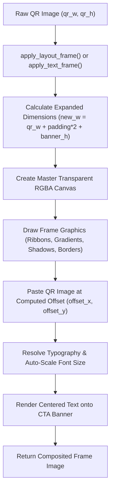

# 🪧 04 - Decorative Text & Layout Framing Engine

> **Architectural breakdown of the 4,400+ line layout framing engine (`backend/engines/frames/text_frames.py`), dynamic canvas geometry scaling, 40+ decorative frame styles, and the TrueType Google Font typography registry.**

---

## 📐 1. Dynamic Canvas Layout Geometry

In `backend/engines/frames/text_frames.py`, frames do not simply draw a border over the QR image; they dynamically expand the canvas dimensions $(new\_w, new\_h)$ to accommodate banners, call-to-actions, headers, speech bubbles, and drop shadows:



---

## 🎨 2. Comprehensive Catalog of 40+ Decorative Frame Styles

Spanning thousands of lines of precise Pillow drawing logic:

| Frame Style | Layout Geometry | Visual Description |
| :--- | :--- | :--- |
| `polaroid` | Extra bottom vertical margin for handwritten/bold caption | Classic vintage instant camera film card. |
| `drop_shadow_card` | Floating elevation with multi-pass Gaussian blur shadow | Modern luxury product card. |
| `balloon` / `speech_bubble` | Top speech bubble with triangular directional pointer | Playful comic dialogue balloon. |
| `banner` | Integrated top and bottom colored banner bands | Bold commercial CTA frame with high-contrast text. |
| `badge_ribbon` | Folded heraldic ribbon banner below QR code | Elegant certified/verified badge. |
| `art_deco` | Stepped geometric corners and double gilded borders | 1920s Great Gatsby luxury aesthetic. |
| `cyberpunk` | Neon cyber-HUD frame with warning chevrons and scanlines | Futuristic sci-fi tech terminal. |
| `browser_window` | Top window header with macOS traffic light buttons | Clean desktop web browser window mockup. |
| `coupon_cutout` | Perforated dashed scissor cut lines around border | E-commerce discount voucher ticket. |
| `phone_mockup` | Smartphone bezel with speaker cutout and camera notch | Realistic mobile screen mockup. |
| `neon_glow_frame` | Multi-layered radial blurred Gaussian glowing tubes | Radiant night-club neon sign. |
| `cellular_automata_frame` | Procedural Conway's Game of Life micro-pixel border | Generative algorithmic digital frame. |
| `crypto_wallet_badge` | Web3 ledger card with verified security crest accents | Cryptocurrency payment badge. |

---

## ✍️ 3. Typography Subsystem & TrueType Font Registry

`FONT_REGISTRY` in `text_frames.py` indexes 12 Google TrueType font files stored in `backend/assets/fonts/`:

```python
FONT_REGISTRY = {
    "Outfit (Modern)": "Outfit-Bold.ttf",
    "Montserrat (Geometric)": "Montserrat-Bold.ttf",
    "Roboto (Clean)": "Roboto-Bold.ttf",
    "Poppins (Friendly)": "Poppins-Bold.ttf",
    "Space Grotesk (Tech)": "SpaceGrotesk-Bold.ttf",
    "Oswald (Bold Condensed)": "Oswald-Bold.ttf",
    "Fira Code (Monospace)": "FiraCode-Bold.ttf",
    "Playfair Display (Elegant)": "PlayfairDisplay-Bold.ttf",
    "Lora (Serif)": "Lora-Bold.ttf",
    "Cinzel (Classic)": "Cinzel-Bold.ttf",
    "Dancing Script (Cursive)": "DancingScript-Bold.ttf",
    "Courier Prime (Retro)": "CourierPrime-Bold.ttf",
}
```

### Auto-Scaling Text Width Resolution:
If user-provided text exceeds the available banner width, the engine iteratively reduces the font size using `font.getbbox(text)` until the text fits comfortably within the banner margins:

```python
def get_fitted_font(text, font_path, max_width, initial_size=60):
    size = initial_size
    font = ImageFont.truetype(font_path, size)
    bbox = font.getbbox(text)
    text_w = bbox[2] - bbox[0]
    
    while text_w > max_width and size > 12:
        size -= 2
        font = ImageFont.truetype(font_path, size)
        bbox = font.getbbox(text)
        text_w = bbox[2] - bbox[0]
        
    return font
```
