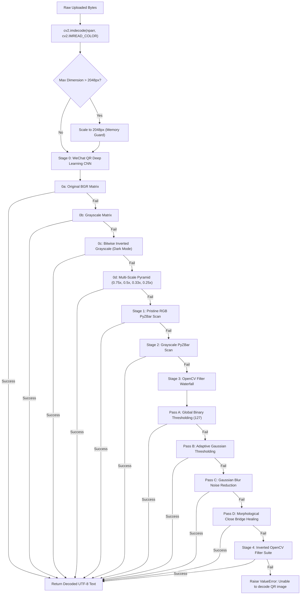

# 🔬 06 - Computer Vision Scanner & Caffe Deep Learning CNN

> **Deep-dive into the AI CNN WeChat QR neural detector, Caffe pre-trained weights, multi-scale image pyramids, and OpenCV + PyZBar waterfall filter pipeline in `backend/services/scan_service.py`.**

---

## 🤖 1. The Multi-Stage Computer Vision Waterfall (`deep_scan_qr`)

`backend/services/scan_service.py` implements a stubborn, multi-tier decoding pipeline capable of recognizing low-contrast, heavily stylized, inverted, damaged, or blurred QR codes:



---

## 🧠 2. AI WeChat QR Detector Architecture

Trained by Tencent/WeChat on millions of real-world barcode samples, the detector is integrated into OpenCV via `cv2.wechat_qrcode_WeChatQRCode`:

- **Detection Network (`detect.prototxt` & `detect.caffemodel` - 965 KB)**: Deep Convolutional Neural Network trained to regress 4-corner quad vertices even under severe affine transformation, shearing, and perspective warp.
- **Super-Resolution Network (`sr.prototxt` & `sr.caffemodel` - 24 KB)**: A compact CNN that enhances and de-blurs low-resolution modules before bit extraction.

```python
models_dir = os.path.abspath(os.path.join(os.path.dirname(__file__), "..", "models", "wechat_qr"))
wechat_detector = cv2.wechat_qrcode_WeChatQRCode(
    os.path.join(models_dir, "detect.prototxt"),
    os.path.join(models_dir, "detect.caffemodel"),
    os.path.join(models_dir, "sr.prototxt"),
    os.path.join(models_dir, "sr.caffemodel")
)
res, points = wechat_detector.detectAndDecode(img)
```

---

## 🧮 3. OpenCV Mathematical Filter Suite

### 1. Adaptive Gaussian Thresholding (`Pass B`):
```python
adaptive = cv2.adaptiveThreshold(
    gray, 255, cv2.ADAPTIVE_THRESH_GAUSSIAN_C, cv2.THRESH_BINARY, 11, 2
)
```
Computes local thresholds dynamically over $11\times 11$ neighborhood blocks. Essential for decoding QR codes with multi-stop linear or radial gradients.

### 2. Gaussian Blur Noise Reduction (`Pass C`):
```python
blurred = cv2.GaussianBlur(gray, (5, 5), 0)
```
Filters out high-frequency visual textures (e.g. `heart`, `star`, or `crossstitch` module shapes) back into continuous module centroids.

### 3. Morphological Close (`Pass D`):
```python
kernel = np.ones((3, 3), np.uint8)
closed = cv2.morphologyEx(thresh, cv2.MORPH_CLOSE, kernel)
```
Performs mathematical dilation followed by erosion. Bridges sub-pixel gaps between discontinuous dot patterns (`gapped`, `minimal_dots`, `circuit_bridge`), restoring topological connectivity.

### 4. Dark-Mode Bitwise Inversion (`Stage 4`):
```python
gray_inv = cv2.bitwise_not(gray)
```
Inverts light-on-dark matrices so traditional decoders expecting dark modules on white canvas can decode successfully.
