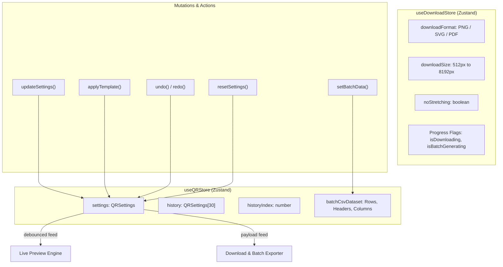

# 🗄️ 02 - State Management & Custom Hooks Architecture

> **Deep-dive into Zustand 5 state stores (`useQRStore`, `useDownloadStore`), intelligent 30-level undo/redo history stacks, clipboard APIs, keyboard shortcuts, and custom React hooks.**

---

## 🏬 1. Zustand Reactive Store Architecture

QR Code Maker 6 uses **Zustand 5** for state management, providing zero-boilerplate reactivity without React Context provider nesting:



---

## 🧠 2. The Intelligent 30-Level Undo/Redo Engine

A major UX flaw in naive undo implementations is that every single character typed in a text field creates an undo snapshot, making it impossible to undo earlier design styling clicks.

`useQRStore.ts` solves this with **Aesthetic vs. Content Mutation Separation**:

```typescript
updateSettings: (newSettings) => set((state) => {
  const nextSettings = { ...state.settings, ...newSettings };

  // 1. Separate Text/Content edits from Visual Design modifications
  const stripAesthetics = (s: QRSettings) => {
    const { contentType, contentData, ...rest } = s;
    return JSON.stringify(rest);
  };

  const aestheticsChanged = stripAesthetics(nextSettings) !== stripAesthetics(state.settings);

  if (!aestheticsChanged) {
    // Only text changed: Update state and retroactively patch existing snapshots
    // DO NOT push a new history entry!
    const updatedHistory = state.history.map(item => ({
      ...item,
      contentType: nextSettings.contentType,
      contentData: nextSettings.contentData
    }));

    return { settings: nextSettings, history: updatedHistory };
  }

  // 2. Aesthetic modified (dot style, color, frame, logo, gradient): Push new snapshot
  const slicedHistory = state.history.slice(0, state.historyIndex + 1);
  const newHistory = [...slicedHistory, nextSettings].slice(-30); // Max 30 snapshots

  return {
    settings: nextSettings,
    history: newHistory,
    historyIndex: newHistory.length - 1
  };
})
```

---

## 📦 3. Export Handlers Hook (`useDownloadHandlers.ts`)

`frontend/src/hooks/useDownloadHandlers.ts` encapsulates all file creation, clipboard operations, and batch CSV processing:

### 1. Single File Download (`handleDownload`):
```typescript
const { blob, ext } = await downloadQR(settings, downloadFormat, downloadSize, noStretching);
const url = URL.createObjectURL(blob);
const a = document.createElement("a");
a.href = url;
a.download = `${customFilename || "qrcode"}.${ext}`;
document.body.appendChild(a);
a.click();
document.body.removeChild(a);
URL.revokeObjectURL(url);
```

### 2. Native Clipboard Copy (`handleCopyImage`):
Directly generates an image blob and writes it to the operating system clipboard using the modern **Async Clipboard API**:
```typescript
const blob = await copyQRToClipboard(settings, downloadSize, noStretching);
await navigator.clipboard.write([
  new ClipboardItem({ [blob.type]: blob })
]);
```

### 3. Complex Styling Guard (`hasComplexStyling`):
SVG vector output cannot natively render certain bitmap-only effects (e.g. Gaussian drop shadows, image background blend modes). `hasComplexStyling` inspects the active settings and displays a warning toast advising the user to export as high-resolution PNG (4K/8K) instead of SVG if complex raster filters are active.

---

## 🎹 4. Keyboard Shortcuts (`useKeyboardShortcuts.ts`)

Binds desktop keyboard shortcuts globally to accelerate creative workflows:

| Shortcut | Action Triggered |
| :--- | :--- |
| **`Ctrl + Z` / `Cmd + Z`** | `undo()` — Reverts to previous design snapshot. |
| **`Ctrl + Y` / `Cmd + Shift + Z`** | `redo()` — Restores next design snapshot. |
| **`Ctrl + D` / `Cmd + D`** | `handleDownload()` — Instantly triggers export download. |
| **`Escape`** | Closes Fullscreen Lightbox or active modal dialog. |

---

## 🔔 5. Ephemeral Notifications (`useToast.ts`)

Managed via `useToastStore.ts`, providing animated floating notifications (Success, Error, Info, Warning) with auto-dismiss timers:
```typescript
const { showToast } = useToast();
showToast("QR Code copied to clipboard!", "success", 3000);
```
