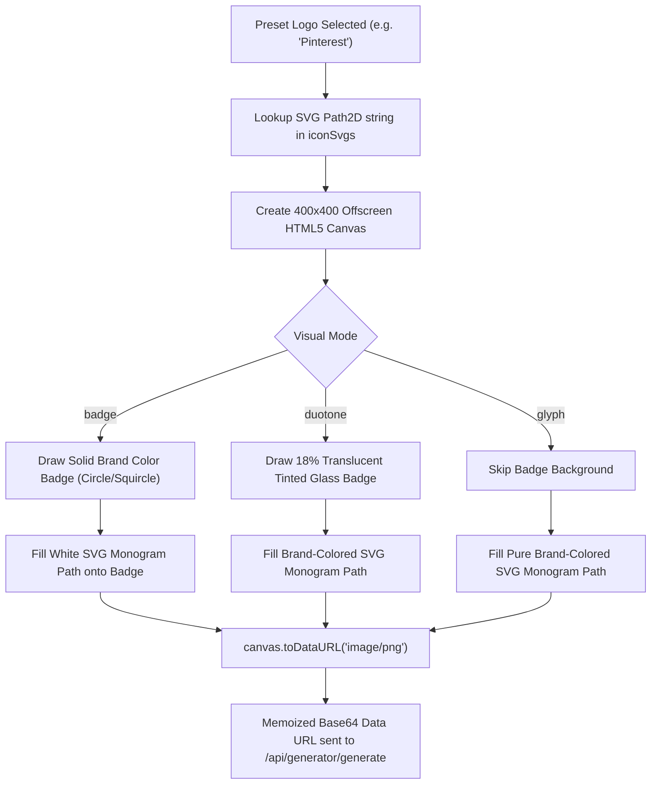

# 🎨 04 - Client Canvas & SVG Vector Preview Pipeline

> **Architectural breakdown of the client-side offscreen canvas rasterizer (`SvgIcons.tsx`), desktop sticky preview pane (`DesktopPreviewPane.tsx`), mobile bottom bar (`MobileBottomBar.tsx`), and fullscreen lightbox (`FullscreenLightbox.tsx`).**

---

## 🖼️ 1. Client-Side Offscreen Canvas Rasterization (`SvgIcons.tsx`)

`frontend/src/components/previews/SvgIcons.tsx` contains an **80KB+ vector library** and a high-performance offscreen HTML5 canvas rasterizer (`getReactLogoPngDataUrl`):



### Path2D Vector Drawing Implementation:
```typescript
export async function getReactLogoPngDataUrl(
  name: string,
  mode: string,
  customColor: string,
  dotsColor: string,
  iconStyle: "badge" | "duotone" | "glyph" = "badge",
  cardShape: "Circle" | "Rounded Square" | "None" = "Rounded Square"
): Promise<string> {
  const canvas = document.createElement("canvas");
  canvas.width = 400;
  canvas.height = 400;
  const ctx = canvas.getContext("2d")!;

  // 1. Draw Background Card Shape
  if (iconStyle !== "glyph" && cardShape !== "None") {
    ctx.fillStyle = iconStyle === "duotone" ? `${brandColor}2E` : brandColor;
    if (cardShape === "Circle") {
      ctx.beginPath();
      ctx.arc(200, 200, 180, 0, Math.PI * 2);
      ctx.fill();
    } else { // Rounded Square
      ctx.beginPath();
      ctx.roundRect(20, 20, 360, 360, 72);
      ctx.fill();
    }
  }

  // 2. Render Scaled SVG Path2D
  ctx.save();
  ctx.translate(100, 100);
  ctx.scale(8.33, 8.33); // Scale 24x24 viewBox to 200x200 pixel box
  const p = new Path2D(svgPathString);
  ctx.fillStyle = iconStyle === "badge" ? "#FFFFFF" : brandColor;
  ctx.fill(p);
  ctx.restore();

  return canvas.toDataURL("image/png");
}
```

---

## 🖥️ 2. Desktop Preview Pane (`DesktopPreviewPane.tsx`)

The right column on desktop remains sticky (`sticky top-24`), keeping the visual output in view as the user scrolls through lengthy editor panels:

### Core Features:
1. **Live Preview Display**: Shows the rendered QR image with smooth transitions and an animated loading spinner overlay during re-fetching.
2. **Real-Time Scannability Meter**: Mounts `ScannabilityAlert.tsx` displaying the live scannability score ($0 \text{ to } 100$) and color-coded status badge (Excellent, Good, Fair, Poor).
3. **Quick Action Toolbar**:
   - **Copy Image**: Copies high-res PNG directly to the clipboard.
   - **Quick Download**: Triggers a fast 1024px PNG export with one click.
   - **Compare Toggle**: Enables side-by-side comparison mode.
   - **Fullscreen Trigger**: Expands the preview into a high-res inspection modal.
4. **Interactive Zoom Controls**: Allows zooming the preview canvas between $75\%$ and $150\%$ scale.

---

## 📱 3. Mobile Viewport Adaptation (`MobileBottomBar.tsx`)

On mobile devices ($< 1024\text{px}$), screen real estate is constrained. The app transforms into a mobile-first native-like experience:

```
┌─────────────────────────────────────────────────────────────┐
│ Mobile Viewport Content Area                                │
│ (Active Panel Form / Dot Selector / Color Pickers)          │
├─────────────────────────────────────────────────────────────┤
│ Floating Mini Preview Bubble (Bottom Right)                 │
│ [Tap to Expand Slide-up Drawer]                             │
├─────────────────────────────────────────────────────────────┤
│ Fixed Bottom Navigation Bar                                 │
│ [📝 Content] [🎨 Design] [🏷️ Logo] [✨ More] [⬇️ Download] │
└─────────────────────────────────────────────────────────────┘
```

1. **Floating Mini Preview**: A circular floating button in the bottom right corner showing a real-time thumbnail of the QR code. Tapping it opens a smooth slide-up bottom sheet with the full preview.
2. **Thumb-Zone Navigation**: Fixed 5-tab bottom navigation optimized for one-handed mobile use.

---

## 🔍 4. Fullscreen Lightbox (`FullscreenLightbox.tsx`)

Provides a distraction-free inspection environment:
- **Background Blur**: `backdrop-filter: blur(24px)` with high-contrast dark overlay.
- **Pan & Zoom**: Mouse wheel zoom and drag-to-pan for inspecting micro-dot geometries at high magnification.
- **Escape Key Listener**: Instantly dismisses the lightbox on `Escape` keypress.
