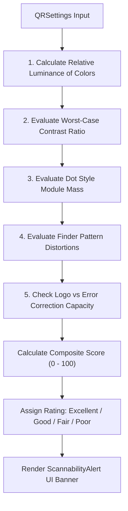

# 🔬 05 - Scannability Calculator & Quality Validation Engine

> **Mathematical and algorithmic deep-dive into the client-side scannability scoring engine (`frontend/src/utils/scannability.ts`), sRGB luminance formulas, WCAG 4.5:1 contrast calculations, and heuristic penalty models.**

---

## 🧮 1. The Scannability Algorithm Overview

`frontend/src/utils/scannability.ts` runs synchronously in the client browser to predict whether a customized QR code can be read by consumer smartphone cameras before downloading:



---

## 📐 2. Mathematical Formulations

### 1. sRGB Relative Luminance Formula (WCAG 2.2 / ISO 9241-392):
Given RGB channel values normalized to $[0, 1]$:

$$C_{\text{linear}} = \begin{cases} \frac{C}{12.92} & \text{if } C \le 0.03928 \\ \left(\frac{C + 0.055}{1.055}\right)^{2.4} & \text{if } C > 0.03928 \end{cases}$$

$$\text{Luminance } L = 0.2126 R_{\text{linear}} + 0.7152 G_{\text{linear}} + 0.0722 B_{\text{linear}}$$

### 2. Contrast Ratio Formula:
$$\text{Contrast Ratio} = \frac{\max(L_1, L_2) + 0.05}{\min(L_1, L_2) + 0.05}$$

---

## ⚖️ 3. Multi-Factor Penalty Matrix

The calculator starts with a perfect score of **100** and deducts penalty points across four critical dimensions:

### 1. Contrast Ratio Evaluation (Worst-Case Gradient Analysis):
For gradient QR codes, the calculator evaluates the contrast of both `dots_color` (start) and `dots_color_end` (end) against `bg_color`:

$$\text{minContrast} = \min(\text{Contrast}(\text{bg}, \text{start}), \text{Contrast}(\text{bg}, \text{end}))$$

| Minimum Contrast | Penalty Deduction | Diagnostic Warning |
| :---: | :---: | :--- |
| **$< 2.5:1$** | **$-40\text{ pts}$** | *"Contrast is too low. Ensure dots are much darker (or lighter) than the background."* |
| **$< 3.5:1$** | **$-20\text{ pts}$** | *"Contrast is a bit low. Some scanners might struggle."* |
| **$< 4.5:1$** | **$-5\text{ pts}$** | Borderline WCAG compliance warning. |
| **$\ge 4.5:1$** | **$0\text{ pts}$** | Optimal contrast. |

---

### 2. Dot Style Module Mass Deduction:
Unusual dot shapes reduce the surface area (black-to-white ratio) within each module, reducing sensor capture confidence:

- **Safe Styles** (`square`, `rounded`, `circle`, `classy`): **$0\text{ pts}$** deduction.
- **Moderate Styles** (`diamond`, `hexagon`, `octagon`, `gapped`): **$-2\text{ pts}$** deduction.
- **Risky Styles** (`star`, `heart`, `plus`, `vertical_bars`, `horizontal_bars`): **$-10\text{ pts}$** deduction (*"Dot style can be harder for older scanners to read"*).
- **Experimental Styles** (`hollow_dots`, `minimal_dots`, `crossstitch`): **$-20\text{ pts}$** deduction (*"Style removes significant module mass"*).

---

### 3. Finder Pattern Geometry Deduction:
Smartphones identify QR symbols by detecting standard $7\times 7$ square finder boxes:
- **Non-Standard Eye Frame**: **$-10\text{ pts}$** deduction (*"Complex eye frames can confuse scanners looking for standard square alignment markers"*).
- **Non-Standard Eyeball**: **$-10\text{ pts}$** deduction (*"Complex eyeballs can distort alignment anchors"*).

---

### 4. Logo & Error Correction Mismatch Deduction:
Center logos cover up to 20–25% of the data grid:
- **Logo with Level L Error Correction (~7%)**: **$-30\text{ pts}$** deduction (*"Adding a logo requires higher Error Correction. Level 'L' is too weak"*).
- **Logo with Level M Error Correction (~15%)**: **$-15\text{ pts}$** deduction (*"Adding a logo normally requires Error Correction 'Q' or 'H'"*).
- **Logo with Level Q or H (25–30%)**: **$0\text{ pts}$** deduction (Safe).

---

## 🏷️ 4. Status Tier Classification

The final clamped score ($0 \le \text{Score} \le 100$) maps to four actionable user-facing tiers:

```typescript
export interface ScannabilityResult {
  score: number;
  label: "Excellent" | "Good" | "Fair" | "Poor";
  color: string;
  issues: string[];
}
```

| Score Range | Status Label | Badge Color | Guidance |
| :---: | :---: | :---: | :--- |
| **$90 \text{ to } 100$** | **Excellent** | `emerald-500` | 100% reliable across all consumer cameras and lighting conditions. |
| **$70 \text{ to } 89$** | **Good** | `yellow-500` | Highly reliable on modern smartphones; minor edge cases on low-end sensors. |
| **$50 \text{ to } 69$** | **Fair** | `orange-500` | Requires direct light; may fail under oblique scan angles. |
| **$< 50$** | **Poor** | `red-500` (error) | **High risk of scan failure**. User must adjust colors or error correction. |
