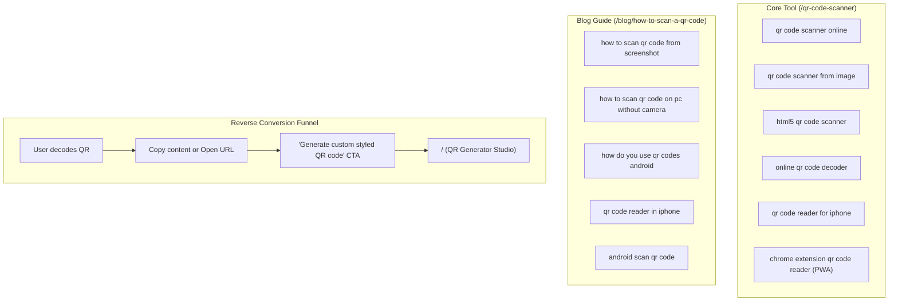

# 📊 13 - QR Scanner Master Keyword Dataset & Search Intelligence Bank

> **Consolidated Market Intelligence & Keyword Dataset for QR Code Scanning & Reading**  
> **Compiled from:** 25 Search Intelligence Datasets (Ubersuggest, NP Digital, Google Search Trends) + AnswerThePublic US Dataset  
> **Total Keywords Categorized:** 120+ Search Terms across 6 Functional Clusters  
> **Application Target:** [GenerateCustomQR / QR Code Maker 6](file:///f:/Project%20001/qr%20code%20generator%206)

---

## 🏛️ 1. Master Keyword Matrix by Core Search Cluster

### 🖼️ Cluster 1: Screenshot, Image & Photo QR Decoding

| Keyword | Monthly Search Volume | Keyword Difficulty (KD) | Intent Type | Target URL / Asset | Priority Tier |
| :--- | :--- | :--- | :--- | :--- | :--- |
| **`how to scan qr code from screenshot`** | >1,000 | **Easy (Green)** | Informational | `/blog/how-to-scan-a-qr-code` | **P0 (Quick-Win)** |
| **`read qr code from image`** | >1,000 | Hard (Red) | Tool / Action | `/qr-code-scanner` (Upload Tab) | **P1 (Core Tool)** |
| **`qr code scanner from image`** | 330 | **19 (Green - Very Easy)** | Tool / Transactional | `/qr-code-scanner` | **P0 (Quick-Win)** |
| **`scan qr code from image`** | >100 | Medium (Yellow) | Tool / Action | `/qr-code-scanner` | **P1** |
| **`android scan qr code from image`** | <100 | **Easy (Green 🔥)** | Android Image Tool | `/blog/how-to-scan-a-qr-code` + `/qr-code-scanner` | **P0 (Quick-Win)** |
| **`scan qr code from image android`** | <100 | **Easy (Green 🔥)** | Android Image Tool | `/blog/how-to-scan-a-qr-code` | **P0 (Quick-Win)** |
| **`scan qr code from image iphone`** | <100 | **Easy (Green 🔥)** | iOS Image Tool | `/blog/how-to-scan-a-qr-code` | **P0 (Quick-Win)** |
| **`scan qr code from image on phone`** | <100 | **Easy (Green 🔥)** | Mobile Image Tool | `/qr-code-scanner` | **P0 (Quick-Win)** |
| **`scan qr code from image on computer`** | <100 | N/A (Low) | Desktop Tool | `/qr-code-scanner` | **P1** |
| **`how to scan qr code from image`** | <100 | Hard (Red) | Informational | `/blog/how-to-scan-a-qr-code` | **P1** |
| **`how to scan qr code from image on phone`** | <100 | N/A (Low) | Mobile Guide | `/blog/how-to-scan-a-qr-code` | **P1** |
| **`how to scan qr code from image on iphone`** | <100 | N/A (Low) | iOS Guide | `/blog/how-to-scan-a-qr-code` | **P1** |
| **`google lens scan qr code from image official`**| <100 | N/A (Low) | Google Lens Guide | `/blog/how-to-scan-a-qr-code` | **P2** |
| **`scan qr code from image online`** | <100 | Hard (Red) | Web Decoder | `/qr-code-scanner` | **P1** |
| **`scan qr code from screenshot`** | >100 | Medium (Yellow) | Tool / Action | `/qr-code-scanner` | **P1** |
| **`read qr code from screenshot`** | <100 | Medium (Yellow) | Tool / Action | `/qr-code-scanner` | **P1** |
| **`how to read qr code from screenshot`** | <100 | **Easy (Green 🔥)** | Informational | `/blog/how-to-scan-a-qr-code` | **P0 (Quick-Win)** |
| **`read qr code from screenshot iphone`** | <100 | N/A (Low) | iOS Guide | `/blog/how-to-scan-a-qr-code` | **P1** |
| **`how to read qr code from screenshot iphone`** | <100 | N/A (Low) | iOS Guide | `/blog/how-to-scan-a-qr-code` | **P1** |
| **`can you read qr code from screenshot`** | <100 | N/A (Low) | Question / FAQ | `/qr-code-scanner#faq` | **P1 (Featured Snippet)** |
| **`can you scan qr code from screenshot`** | >100 | **Easy (Green)** | Question / FAQ | `/qr-code-scanner#faq` | **P0 (Featured Snippet)** |
| **`open qr code from image`** | >100 | **Easy (Green)** | Action | `/qr-code-scanner` | **P1** |
| **`qr code from image`** | >100 | **Easy (Green)** | Broad Tool | `/qr-code-scanner` | **P1** |
| **`how to scan qr code from screenshot iphone`** | <100 | **Easy (Green)** | Device Guide | `/blog/how-to-scan-a-qr-code` | **P1** |
| **`scan qr code from screenshot iphone`** | <100 | **Easy (Green)** | Device Guide | `/blog/how-to-scan-a-qr-code` | **P1** |
| **`how to scan qr code from screenshot android`** | <100 | **Easy (Green)** | Device Guide | `/blog/how-to-scan-a-qr-code` | **P1** |
| **`scan qr code from screenshot android`** | <100 | **Easy (Green)** | Device Guide | `/blog/how-to-scan-a-qr-code` | **P1** |
| **`how to scan qr code from screenshot samsung`** | <100 | **Easy (Green)** | Device Guide | `/blog/how-to-scan-a-qr-code` | **P1** |
| **`qr code scanner from image paste`** | <100 | **Easy (Green)** | Feature Action | `/qr-code-scanner` (Clipboard Prompt) | **P0 (UX Goldmine)** |
| **`qr code scanner from image clipboard`** | <100 | **Easy (Green)** | Feature Action | `/qr-code-scanner` (Ctrl+V) | **P0 (UX Goldmine)** |
| **`qr code scanner from image upload`** | <100 | N/A (Low) | Tool Action | `/qr-code-scanner` (Upload Tab) | **P1** |
| **`qr code scanner from image pc`** | <100 | N/A (Low) | Desktop Tool | `/qr-code-scanner` | **P1** |
| **`qr code scanner from image free`** | <100 | N/A (Low) | Commercial | `/qr-code-scanner` | **P1** |
| **`web qr code scanner from image`** | <100 | N/A (Low) | Web Tool | `/qr-code-scanner` | **P1** |
| **`online qr code scanner from image url`** | <100 | N/A (Low) | Remote URL Decoder | `/qr-code-scanner` | **P2** |
| **`best online qr code scanner from image 2026`** | <100 | N/A (Low) | Evergreen Query | `/blog/how-to-scan-a-qr-code` | **P1** |
| **`qr code scanner online from image`** | <100 | Hard (Red) | Long-tail Tool | `/qr-code-scanner` | **P2** |
| **`qr code scanner online image`** | <100 | N/A (Low) | Long-tail Tool | `/qr-code-scanner` | **P2** |

---

### 💻 Cluster 2: PC, Laptop, Mac & Desktop Scanning (Without Camera)

| Keyword | Monthly Search Volume | Keyword Difficulty (KD) | Intent Type | Target URL / Asset | Priority Tier |
| :--- | :--- | :--- | :--- | :--- | :--- |
| **`qr code scanner for pc`** | >100 | Hard (Red) | Desktop Tool | `/qr-code-scanner` | **P1** |
| **`how to scan qr code on pc`** | >100 | **Easy (Green)** | Informational | `/blog/how-to-scan-a-qr-code` | **P0 (Quick-Win)** |
| **`scan qr code on pc`** | >100 | Hard (Red) | Desktop Tool | `/qr-code-scanner` | **P1** |
| **`how to scan qr code on pc without camera`** | <100 | **Easy (Green)** | Problem-Solving | `/blog/how-to-scan-a-qr-code` | **P0 (Killer Feature)** |
| **`scan qr code on pc without camera`** | <100 | N/A (Low) | Problem-Solving | `/qr-code-scanner` | **P0** |
| **`qr code scanner for pc windows 10`** | <100 | Hard (Red) | OS Desktop | `/qr-code-scanner` | **P1** |
| **`qr code scanner for pc online`** | <100 | Hard (Red) | Desktop Web | `/qr-code-scanner` | **P1** |
| **`google qr code scanner for pc`** | <100 | N/A (Low) | Brand / Desktop | `/blog/how-to-scan-a-qr-code` | **P1** |
| **`qr code scanner for pc camera`** | <100 | N/A (Low) | Hardware Webcam | `/qr-code-scanner` (Webcam) | **P1** |
| **`wifi qr code scanner for pc`** | <100 | N/A (Low) | WiFi on PC | `/wifi-qr-code` | **P1** |
| **`wifi qr code scanner for pc windows 10`** | <100 | N/A (Low) | WiFi Windows 10 | `/wifi-qr-code` | **P2** |
| **`wifi qr code scanner for pc windows 7`** | <100 | N/A (Low) | Legacy OS | `/wifi-qr-code` | **P2** |
| **`free qr code scanner for pc`** | <100 | N/A (Low) | Free Desktop Tool | `/qr-code-scanner` | **P1** |
| **`qr code scanner for pc free download`** | <100 | N/A (Low) | Download Intent | `/qr-code-scanner` (Web Alt) | **P1** |
| **`how to scan qr code on pc for wifi`** | <100 | N/A (Low) | Technical Guide | `/blog/how-to-scan-a-qr-code` | **P2** |
| **`qr code scanner for laptop`** | >100 | Hard (Red) | Laptop Tool | `/qr-code-scanner` | **P1** |
| **`free qr code scanner for laptop`** | <100 | N/A (Low) | Free Laptop Tool | `/qr-code-scanner` | **P1** |
| **`free download qr code scanner for laptop`** | <100 | N/A (Low) | Download Intent | `/qr-code-scanner` (Web Alt) | **P1** |
| **`download qr code scanner for laptop`** | <100 | N/A (Low) | Download Intent | `/qr-code-scanner` (Web Alt) | **P2** |
| **`wifi qr code scanner for laptop free download`** | <100 | N/A (Low) | WiFi on Laptop | `/wifi-qr-code` | **P2** |
| **`scan qr code laptop mac`** | <100 | N/A (Low) | Device Guide | `/qr-code-scanner` | **P2** |
| **`qr code scanner online webcam`** | <100 | N/A (Low) | Hardware Tool | `/qr-code-scanner` (Camera Tab) | **P2** |
| **`chrome extension qr code reader`** | 590 | **9 (Green - Super Easy!)** | Browser Extension / PWA | `/qr-code-scanner` (PWA Banner) | **P0 (Ultra High ROI)** |

---

### 🌐 Cluster 3: Online, Web-Based & HTML5 In-Browser Scanners

| Keyword | Monthly Search Volume | Keyword Difficulty (KD) | Intent Type | Target URL / Asset | Priority Tier |
| :--- | :--- | :--- | :--- | :--- | :--- |
| **`qr code scanner online`** | **2,400** | **60 (Moderate)** | Transactional Tool | `/qr-code-scanner` (H1 Seed) | **P0 (Primary Anchor)** |
| **`online qr code scanner`** | **>1,000** | Hard (Red) | Transactional Tool | `/qr-code-scanner` | **P1** |
| **`qr code scanner online free`** | **>1,000** | Hard (Red) | Commercial Tool | `/qr-code-scanner` | **P1** |
| **`scan qr code online`** | **1,800** | 56 (Moderate) | Action / Tool | `/qr-code-scanner` | **P1** |
| **`scanner online`** | 1,500 | 57 (Moderate) | Broad Search | `/qr-code-scanner` | **P2** |
| **`barcode scanner online`** | 1,300 | 56 (Moderate) | Multi-format Tool | `/qr-code-scanner` | **P2** |
| **`qr code scanner website`** | >100 | N/A (Low) | Navigational | `/qr-code-scanner` | **P1** |
| **`scanner online free`** | 660 | 41 (Moderate) | Commercial | `/qr-code-scanner` | **P2** |
| **`html5 qr code scanner`** | **590** | **19 (Green - Very Easy!)** | Technical Authority | `/qr-code-scanner` | **P0 (Tech Authority)** |
| **`online barcode reader`** | 590 | 46 (Moderate) | Utility | `/qr-code-scanner` | **P2** |
| **`read a barcode online`** | 590 | 40 (Moderate) | Action | `/qr-code-scanner` | **P2** |
| **`online qr code decoder`** | **480** | **35 (Green - Easy)** | Tech / Decoder | `/qr-code-scanner` | **P0 (Quick-Win)** |
| **`qr code scanner online mobile`** | >100 | Hard (Red) | Mobile Web | `/qr-code-scanner` | **P1** |
| **`qr code scanner online mobile free`** | <100 | N/A (Low) | Mobile Web | `/qr-code-scanner` | **P2** |
| **`qr code scanner online mobile camera`** | <100 | N/A (Low) | Mobile Camera | `/qr-code-scanner` | **P2** |
| **`qr code scanner online mobile photo`** | <100 | N/A (Low) | Mobile Photo | `/qr-code-scanner` | **P2** |
| **`google qr code scanner online mobile`** | <100 | N/A (Low) | Chrome Mobile | `/qr-code-scanner` | **P2** |
| **`qr code scanner online free reader`** | <100 | N/A (Low) | Web Tool | `/qr-code-scanner` | **P1** |
| **`qr code scanner online free google`** | <100 | Hard (Red) | Google Integration | `/qr-code-scanner` (Chrome/Lens) | **P1** |
| **`google map qr code scanner online free`** | <100 | N/A (Low) | Maps / Location | `/qr-code-scanner` + `/blog/qr-code-for-google-maps` | **P0 (Feature Match)** |
| **`qr code reader online`** | **>1,000** | Hard (Red) | Semantic Peer Tool | `/qr-code-scanner` (Title & H1 alternate) | **P0 (High-Volume)** |
| **`qr code reader online free`** | <100 | Hard (Red) | Commercial Tool | `/qr-code-scanner` | **P1** |
| **`free qr code reader online`** | <100 | Hard (Red) | Commercial Tool | `/qr-code-scanner` | **P1** |
| **`qr code reader online from image`** | <100 | Hard (Red) | Image Decoder | `/qr-code-scanner` (Upload Tab) | **P1** |
| **`qr code reader online upload image`** | <100 | N/A (Low) | Upload Action | `/qr-code-scanner` (Upload Tab) | **P1** |
| **`wifi qr code scanner`** | <100 | Medium (Yellow) | WiFi QR Tool | `/wifi-qr-code` + `/qr-code-scanner` | **P0 (Feature Silo)** |
| **`wifi qr code scanner online`** | <100 | Medium (Yellow) | WiFi Web Tool | `/wifi-qr-code` | **P1** |
| **`laptop wifi qr code scanner`** | <100 | N/A (Low) | Laptop WiFi | `/wifi-qr-code` | **P1** |
| **`windows wifi qr code scanner`** | <100 | N/A (Low) | Windows WiFi | `/wifi-qr-code` | **P1** |
| **`wifi qr code scanner qr code generator free wifi`** | <100 | N/A (Low) | Dual Intent | `/wifi-qr-code` (Cross-link) | **P1** |

---

### 📱 Cluster 4: Android & iOS Platform-Specific Searches

| Keyword | Monthly Search Volume | Keyword Difficulty (KD) | Intent Type | Target URL / Asset | Priority Tier |
| :--- | :--- | :--- | :--- | :--- | :--- |
| **`qr code scanner android`** | >1,000 | Hard (Red) | OS Search | `/qr-code-scanner` + Blog | **P1** |
| **`android barcode scanner`** | 720 | **31 (Green - Easy)** | Android Utility | `/qr-code-scanner` | **P0 (Quick-Win)** |
| **`scan qr code android`** | 610 | **34 (Green - Easy)** | Action Guide | `/blog/how-to-scan-a-qr-code` | **P0 (Quick-Win)** |
| **`qr code reader for iphone`** | 590 | **26 (Green - Very Easy)** | iOS Tool | `/qr-code-scanner` | **P0 (Quick-Win)** |
| **`qr code reader in iphone`** | 590 | **25 (Green - Very Easy)** | iOS Guide | `/blog/how-to-scan-a-qr-code` | **P0 (Quick-Win)** |
| **`qr code and barcode scanner for android`** | 590 | **26 (Green - Very Easy)** | Multi-format Android | `/qr-code-scanner` | **P0 (Quick-Win)** |
| **`qr code scanner smartphone`** | 590 | **32 (Green - Easy)** | Mobile General | `/qr-code-scanner` | **P0 (Quick-Win)** |
| **`qr code scanner for smartphones`** | 590 | **32 (Green - Easy)** | Mobile General | `/qr-code-scanner` | **P0 (Quick-Win)** |
| **`free qr code scanner app for android`** | 480 | **23 (Green - Very Easy)** | App Search | `/qr-code-scanner` (Web Alternative) | **P0 (Quick-Win)** |
| **`how do you use qr codes android`** | 480 | **19 (Green - Very Easy)** | Educational | `/blog/how-to-scan-a-qr-code` | **P0 (Quick-Win)** |
| **`how to read qr code android`** | 480 | **34 (Green - Easy)** | Educational | `/blog/how-to-scan-a-qr-code` | **P0 (Quick-Win)** |
| **`android qr code scanner`** | 470 | **39 (Easy/Moderate)** | Android Tool | `/qr-code-scanner` | **P1** |
| **`android scan qr code`** | 470 | **26 (Green - Very Easy)** | Action | `/blog/how-to-scan-a-qr-code` | **P0 (Quick-Win)** |
| **`free qr code reader android`** | 390 | **28 (Green - Very Easy)** | Free Tool | `/qr-code-scanner` | **P0 (Quick-Win)** |
| **`free qr code scanner for iphone`** | >100 | Medium (Yellow) | iOS Free Tool | `/qr-code-scanner` (iOS Card) | **P1** |
| **`qr code scanner for iphone`** | <100 | Medium (Yellow) | iOS Tool | `/qr-code-scanner` (iOS Card) | **P1** |
| **`best qr code scanner for iphone`** | <100 | **Easy (Green)** | iOS Review | `/blog/how-to-scan-a-qr-code` | **P0 (Quick-Win)** |
| **`best free qr code scanner for iphone`** | <100 | Medium (Yellow) | iOS Free Review | `/blog/how-to-scan-a-qr-code` | **P1** |
| **`qr code scanner for iphone free`** | <100 | N/A (Low) | iOS Free Tool | `/qr-code-scanner` | **P1** |
| **`samsung qr code scanner`** | >100 | N/A (Low) | Brand Guide | `/blog/how-to-scan-a-qr-code` | **P1** |
| **`qr code scanner google`** | <100 | Hard (Red) | Brand / Engine | `/blog/how-to-scan-a-qr-code` (Google Lens Guide) | **P1** |
| **`qr code scanner google chrome`** | <100 | N/A (Low) | Browser Scan | `/qr-code-scanner` (Chrome Camera) | **P1** |
| **`qr code scanner google pixel 7 pro`** | <100 | N/A (Low) | Hardware Guide | `/blog/how-to-scan-a-qr-code` (Pixel Guide) | **P2** |
| **`qr code scanner google play`** | <100 | N/A (Low) | App Search | `/qr-code-scanner` (Web Alternative) | **P2** |
| **`qr code scanner google play store`** | <100 | N/A (Low) | App Store Intent| `/qr-code-scanner` (Web Alternative) | **P2** |

---

### 📦 Cluster 5: High-Volume Seed & App Download Traffic (Red Ocean vs Web Alternative)

| Keyword | Monthly Search Volume | Keyword Difficulty (KD) | Intent Type | Strategic Angle |
| :--- | :--- | :--- | :--- | :--- |
| **`qr code scanner`** | **201,000** | 91 (Very Hard) | Seed / Tool | Target via long-term topical authority & domain rank |
| **`scan`** | 135,000 | 92 (Very Hard) | Navigational | Brand seed |
| **`scan a qr code`** | 135,000 | 92 (Very Hard) | Action | Core site anchor text |
| **`qr-code`** | 135,000 | 98 (Very Hard) | Entity | Domain core entity |
| **`barcode scanner`** | 74,000 | 85 (Very Hard) | Seed | Cross-support 1D/2D scanner tag |
| **`scan qr codes`** | 49,500 | 92 (Very Hard) | Action | Core CTA text |
| **`qr scanner`** | 40,500 | 88 (Very Hard) | Seed | Header navigation link name |
| **`qr code reader`** | 40,500 | 87 (Very Hard) | Seed | Meta title alternate entity |
| **`qr code scanner app`** | 14,800 | 92 (Very Hard) | App Search | "No Download Needed — Instant Web Scanner" |
| **`barcode reader`** | 12,100 | 82 (Very Hard) | Seed | Barcode compatibility callout |
| **`qr reader`** | 9,900 | 72 (Hard) | Seed | Short synonym |
| **`qr scanner app`** | 8,100 | 74 (Hard) | App Search | Browser PWA alternative |
| **`free qr code scanner`** | 1,500 | 68 (Hard) | Commercial | "100% Free Forever" badge |
| **`scan qr code scanner`** | 1,300 | 62 (Moderate) | Action | Synonymous search |
| **`qr code scanner apk`** | 1,300 | 61 (Moderate) | Download APK | "Scan Safely Online Without Risky APKs" |
| **`qr code scanner free download`** | 480 | 43 (Moderate) | Download | Direct alternative CTA |
| **`qr scanner free download`** | 480 | 43 (Moderate) | Download | Direct alternative CTA |
| **`download qr code scanner`** | <100 | Hard (Red) | Download Search | Intercept: *"No download needed — instant web tool"* |
| **`download qr code scanner for pc`** | <100 | N/A (Low) | Desktop Download | Intercept: *"Scan directly in browser on PC"* |
| **`download qr code scanner for android`** | <100 | N/A (Low) | Android Download | Intercept: *"Safe browser scan without Play Store ads"* |
| **`download qr code scanner free`** | <100 | N/A (Low) | Free Download | Intercept: *"100% Free online scanner"* |
| **`download qr code scanner app`** | <100 | N/A (Low) | App Download | PWA / Browser shortcut option |
| **`free qr code scanner online`** | <100 | Hard (Red) | Commercial Tool | `/qr-code-scanner` |
| **`download free qr code scanner`** | <100 | Hard (Red) | Download Search | Intercept: *"No download required"* |
| **`is there a free qr code scanner`** | <100 | Hard (Red) | Question / FAQ | `/qr-code-scanner#faq` (Direct Snippet) |
| **`what is the best free qr code scanner`** | <100 | N/A (Low) | Question / FAQ | `/blog/how-to-scan-a-qr-code` |
| **`best free qr code scanner for iphone`** | <100 | Medium (Yellow) | iOS Review | `/blog/how-to-scan-a-qr-code` |
| **`best free qr code scanner for android`** | <100 | N/A (Low) | Android Review | `/blog/how-to-scan-a-qr-code` |
| **`best free qr code scanner app`** | <100 | N/A (Low) | Comparison | `/blog/how-to-scan-a-qr-code` |
| **`free qr scanner app`** | >100 | Hard (Red) | App Search | Browser PWA alternative |
| **`free qr scanner app for android`** | >100 | Hard (Red) | Android App | Android Web alternative |
| **`free qr scanner app for iphone`** | <100 | Medium (Yellow) | iOS App | iOS Web alternative |
| **`best free qr scanner app for android`** | <100 | Medium (Yellow) | Android Review | `/blog/how-to-scan-a-qr-code` |
| **`is there a free qr scanner app`** | <100 | N/A (Low) | Question / FAQ | `/qr-code-scanner#faq` (Direct Snippet) |
| **`qr code scanner app source code`** | <100 | N/A (Low) | Developer Intent | Tech documentation on HTML5/WebAssembly decoding |

---

### 🛍️ Cluster 6: Specialized, Brand & Niche Long-Tail Queries

| Keyword | Monthly Search Volume | Intent Type | Content & Tool Fit |
| :--- | :--- | :--- | :--- |
| **`amazon qr code scanner`** | High (ATP Top) | Brand Return Intent | Guide: "How to Scan Amazon Return QR Codes at UPS" |
| **`wechat qr code scanner online`** | <100 | Cross-Border Messaging | Support WeChat Pay & QR decoding |
| **`lego qr code scanner`** | >100 | Gaming / Toy App | Guide on LEGO instruction manual QR codes |
| **`alight motion qr code scanner online`** | <100 | Video Editing Presets | XML / Preset QR code import tool |
| **`smart card qr code scanner online`** | <100 | Identity / NFC / Smart Cards | vCard / Contact parsing showcase |
| **`louis vuitton qr code scanner online`** | <100 | Luxury Authentication | NFC / QR authenticity verification guide |
| **`freescan® qr code scanner`** | >100 | 3D Scanning Hardware | Disambiguation FAQ |

---

### 🔄 Cluster 7: Hybrid "Scanner + Generator (All-in-One Suite)" Queries

| Keyword | Monthly Search Volume | Keyword Difficulty (KD) | Intent Type | Strategic Asset & Placement | Priority Tier |
| :--- | :--- | :--- | :--- | :--- | :--- |
| **`qr code scanner generator`** | **>100** | Hard (Red) | Dual-Tool Suite | Global Header Nav / Homepage H2 | **P0 (Platform Core)** |
| **`qr code scanner generator free`** | <100 | N/A (Low) | Commercial Suite | Homepage Hero & Features Grid | **P1** |
| **`qr code scanner generator online`** | <100 | N/A (Low) | Web Suite | Homepage Meta & Subtitle | **P1** |
| **`free qr code scanner generator`** | <100 | N/A (Low) | Commercial Suite | Footer & FAQ Schema | **P1** |
| **`qr code scanner generator apk`** | <100 | N/A (Low) | Download Intent | PWA Installation Banner | **P2** |

---

### 💬 Cluster 8: WhatsApp & Messaging App QR Scanning Intelligence

| Keyword | Monthly Search Volume | Keyword Difficulty (KD) | Intent Type | Target Strategy & Content Fit | Priority Tier |
| :--- | :--- | :--- | :--- | :--- | :--- |
| **`whatsapp qr code scanner`** | <100 | Medium (Yellow) | App Feature Search | Guide: *"How to Scan WhatsApp Web QR Codes on Phone & PC"* | **P0 (High-Traffic Guide)** |
| **`whatsapp qr code scanner online`** | <100 | Hard (Red) | Web WhatsApp Query | Disambiguation & Web login guide | **P1** |
| **`whatsapp qr code scanner location`** | <100 | N/A (Low) | App Navigation Help | Direct FAQ / Snippet on finding `Linked Devices` | **P0 (Featured Snippet)** |
| **`whatsapp qr code scanner iphone`** | <100 | N/A (Low) | iOS App Guide | iPhone step-by-step: `Settings → Linked Devices → Link a Device` | **P1** |
| **`whatsapp qr code scanner web`** | <100 | N/A (Low) | Desktop Login | Guide on syncing WhatsApp Web via QR code | **P1** |
| **`web whatsapp qr code scanner`** | <100 | N/A (Low) | Desktop Login | Guide on syncing WhatsApp Web via QR code | **P1** |
| **`online whatsapp qr code scanner`** | <100 | N/A (Low) | Web Utility | Explanation of WhatsApp end-to-end security & scanning | **P2** |
| **`whatsapp qr code scanner online for pc`** | <100 | N/A (Low) | PC Web Login | Guide on WhatsApp desktop pairing | **P1** |
| **`whatsapp qr code scanner app for pc`** | <100 | N/A (Low) | Desktop App Search | Intercept WhatsApp Windows app searchers | **P2** |
| **`whatsapp qr code scanner phone`** | <100 | N/A (Low) | Mobile Scanning | In-app scanner tutorial | **P2** |
| **`whatsapp qr code scanner in mobile`** | <100 | N/A (Low) | Mobile Navigation | In-app scanner tutorial | **P2** |
| **`download whatsapp qr code scanner`** | <100 | N/A (Low) | Download Search | Clarify: *"Built directly into WhatsApp app — no extra download needed"* | **P2** |

---

### 🛡️ Cluster 9: "Zero-Install / Scan Without App" Intent Cluster

| Keyword | Monthly Search Volume | Keyword Difficulty (KD) | Intent Type | Target Strategy & Placement | Priority Tier |
| :--- | :--- | :--- | :--- | :--- | :--- |
| **`scan qr code without app`** | **>100** | Hard (Red) | High-Converting Tool | [`/qr-code-scanner`](file:///f:/Project%20001/qr%20code%20generator%206/frontend/src/pages/qr-code-scanner.astro) (Hero Badge & H1) | **P0 (Primary Value Prop)** |
| **`how to scan qr code without app`** | <100 | Hard (Red) | Informational Guide | [`/blog/how-to-scan-a-qr-code`](file:///f:/Project%20001/qr%20code%20generator%206/frontend/src/content/blog/how-to-scan-a-qr-code.md) (H2 Direct Answer) | **P0 (Featured Snippet)** |
| **`scan qr code without app iphone`** | <100 | Hard (Red) | iOS Native Guide | iOS Camera tutorial & web scanner | **P1** |
| **`android scan qr code without app`** | <100 | N/A (Low) | Android Guide | Google Lens & Android Camera tutorial | **P1** |
| **`scan qr code without app free`** | <100 | N/A (Low) | Free Web Scanner | Hero Badge: *"100% Free, No App Install Required"* | **P1** |

---

## 🎯 2. The Top 19 "Zero-Resistance" Keyword Targets (KD ≤ 35)

These 19 exact keywords combine low competition (KD ≤ 35) with high intent and search volume, making them the fastest routes to Page 1 rankings:

```
┌────┬────────────────────────────────────────────┬────────────┬───────────┬───────────────────────────────┐
│ #  │ Keyword                                    │ Est. Volume│ KD Score  │ Target Content Asset          │
├────┼────────────────────────────────────────────┼────────────┼───────────┼───────────────────────────────┤
│ 1  │ chrome extension qr code reader            │    590     │  9 (🔥)   │ /qr-code-scanner (PWA Guide)  │
│ 2  │ html5 qr code scanner                      │    590     │ 19 (🔥)   │ /qr-code-scanner (Tech Specs) │
│ 3  │ how do you use qr codes android            │    480     │ 19 (🔥)   │ /blog/how-to-scan-a-qr-code   │
│ 4  │ qr code scanner from image                 │    330     │ 19 (🔥)   │ /qr-code-scanner (Upload UI)  │
│ 5  │ free qr code scanner app for android       │    480     │ 23 (🔥)   │ /qr-code-scanner (Web Alt)    │
│ 6  │ qr code reader in iphone                   │    590     │ 25 (🔥)   │ /blog/how-to-scan-a-qr-code   │
│ 7  │ qr code reader for iphone                  │    590     │ 26 (🔥)   │ /qr-code-scanner (iOS Card)   │
│ 8  │ qr code and barcode scanner for android    │    590     │ 26 (🔥)   │ /qr-code-scanner (Android)    │
│ 9  │ android scan qr code                       │    470     │ 26 (🔥)   │ /blog/how-to-scan-a-qr-code   │
│ 10 │ free qr code reader android                │    390     │ 28 (🔥)   │ /qr-code-scanner (Hero Badge) │
│ 11 │ android barcode scanner                    │    720     │ 31 (🔥)   │ /qr-code-scanner              │
│ 12 │ qr code scanner smartphone                 │    590     │ 32 (🔥)   │ /qr-code-scanner              │
│ 13 │ qr code scanner for smartphones            │    590     │ 32 (🔥)   │ /qr-code-scanner              │
│ 14 │ online qr code decoder                     │    480     │ 35 (🔥)   │ /qr-code-scanner (Tech Specs) │
│ 15 │ android scan qr code from image            │   <100     │ Easy (🔥) │ /blog/how-to-scan-a-qr-code   │
│ 16 │ scan qr code from image iphone             │   <100     │ Easy (🔥) │ /blog/how-to-scan-a-qr-code   │
│ 17 │ scan qr code from image on phone           │   <100     │ Easy (🔥) │ /qr-code-scanner (Mobile UI)  │
│ 18 │ how to scan qr code from screenshot        │  >1,000    │ Easy (🔥) │ /blog/how-to-scan-a-qr-code   │
│ 19 │ how to read qr code from screenshot        │   <100     │ Easy (🔥) │ /blog/how-to-scan-a-qr-code   │
└────┴────────────────────────────────────────────┴────────────┴───────────┴───────────────────────────────┘
```

---

## 🏗️ 3. Information Architecture & Content Distribution Plan



---

## 📑 4. Structured Schema & Snippet Blueprints

### A. HowTo Schema (Targeting `how to scan qr code from screenshot`):
```json
{
  "@context": "https://schema.org",
  "@type": "HowTo",
  "name": "How to Scan a QR Code from a Screenshot or Saved Image",
  "description": "Learn how to decode and read a QR code from a screenshot without needing a second phone or an app download.",
  "step": [
    {
      "@type": "HowToStep",
      "name": "Take or save the screenshot",
      "text": "Capture the QR code on your screen using Win+Shift+S (PC), Cmd+Shift+4 (Mac), or standard phone screenshot keys."
    },
    {
      "@type": "HowToStep",
      "name": "Open GenerateCustomQR Web Scanner",
      "text": "Visit generatecustomqr.com/qr-code-scanner in any desktop or mobile browser."
    },
    {
      "@type": "HowToStep",
      "name": "Paste or Upload Image",
      "text": "Press Ctrl+V (Cmd+V on Mac) to paste directly from your clipboard, or click 'Upload Image' to choose the file. The code will be decoded instantly."
    }
  ]
}
```

### B. FAQ Schema (Targeting `can you scan qr code from screenshot` & `how to scan qr code on pc without camera`):
```json
{
  "@context": "https://schema.org",
  "@type": "FAQPage",
  "mainEntity": [
    {
      "@type": "Question",
      "name": "Can you scan a QR code from a screenshot?",
      "acceptedAnswer": {
        "@type": "Answer",
        "text": "Yes! You do not need to print out the code or scan it with another phone. On our online scanner, simply drag and drop the screenshot image or press Ctrl+V / Cmd+V to paste it directly into the decoder."
      }
    },
    {
      "@type": "Question",
      "name": "How do I scan a QR code on a PC without a camera or webcam?",
      "acceptedAnswer": {
        "@type": "Answer",
        "text": "Use the Windows Snipping Tool (Win + Shift + S) to capture the QR code on your monitor, then go to generatecustomqr.com/qr-code-scanner and press Ctrl+V. The web decoder reads the image data locally in your browser."
      }
    }
  ]
}
```
