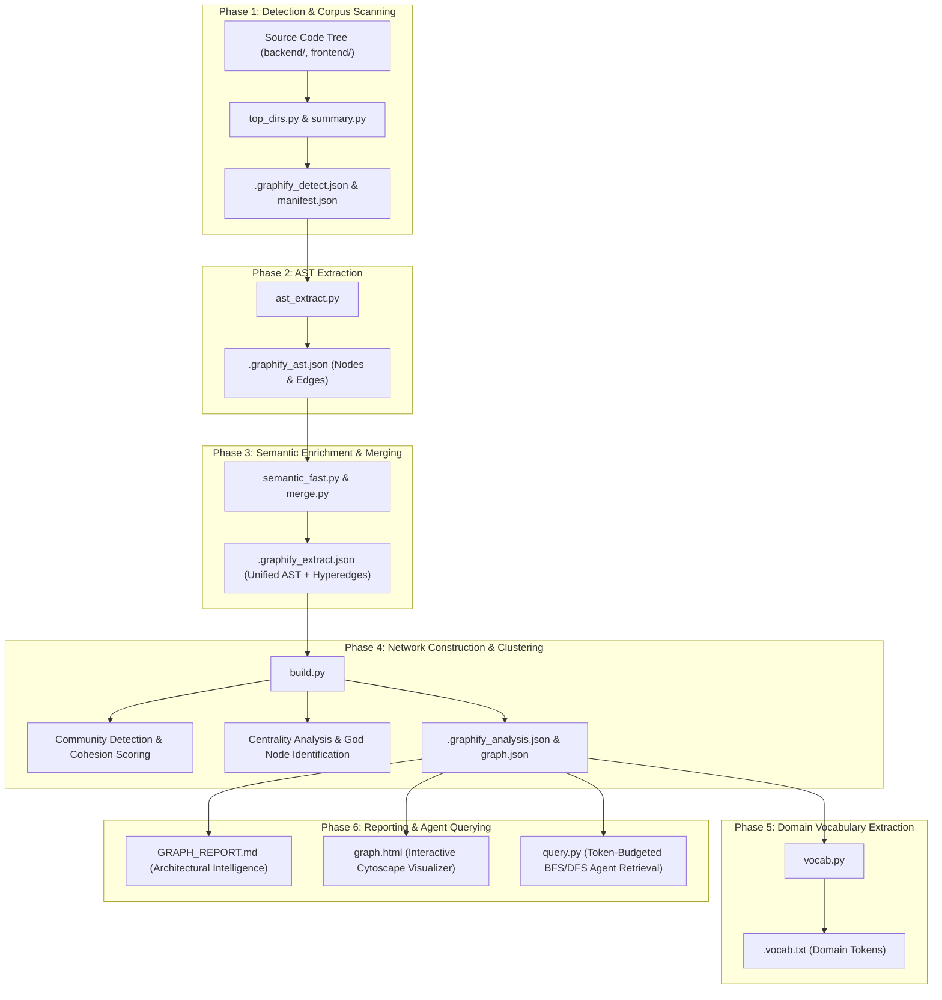

# 🕸️ 00 - Graphify System Overview & Knowledge Graph Architecture

> **Executive architectural reference for the Graphify code graph analysis system, the 6-phase extraction pipeline, AST dependency mapping, community clustering, and agent query integration in `graphify-out/`.**

---

## 📌 1. What is Graphify?

**Graphify** is an automated code intelligence and knowledge graph generation engine integrated into **QR Code Maker 6**. It converts raw source code files (Python, TypeScript, Astro, CSS) into a structured, queryable **AST dependency network graph**:

- **Static AST Extraction**: Parses code into formal structural nodes (Functions, Classes, Methods, Global Constants) and directed relationship edges (`calls`, `imports`, `defines`, `inherits`).
- **Graph Topology & Centrality**: Calculates node degree distributions to identify foundational architectural hubs ("God Nodes") and evaluate modularity cohesion.
- **Community Clustering**: Automatically clusters hundreds of code symbols into functional modules using network graph community detection algorithms.
- **Cycle & Anomaly Detection**: Proves the absence of circular import dependencies and flags surprising cross-boundary invocations.
- **Token-Budgeted AI Subgraph Retrieval**: Powers `query.py`, allowing AI coding agents to retrieve precise, token-bounded topological subgraphs before performing complex code refactoring.

---

## 🔄 2. The 6-Phase Graphify Processing Pipeline



---

## 📁 3. Directory Map of `graphify-out/`

```
graphify-out/
├── build.py                        # Master graph builder, clustering, and report generator
├── ast_extract.py                  # Static AST file collector and parser
├── merge.py                        # Combines AST structural nodes with semantic hyperedges
├── query.py                        # BFS/DFS token-budgeted graph traversal tool for agents
├── vocab.py                        # Domain token identifier extractor (camelCase/snake_case)
├── top_dirs.py                     # Directory file-count frequency aggregator
├── summary.py                      # Corpus word/file count inspector
├── semantic_fast.py                # Semantic graph stub/generator
├── GRAPH_REPORT.md                 # Human-readable architectural report
├── graph.html                      # Interactive visual graph canvas (HTML/D3/Cytoscape)
├── graph.json                      # Serialized networkx node-link graph dataset (290 KB)
├── manifest.json                   # File hash manifest for incremental caching (13 KB)
├── cost.json                       # Token and computational cost tracking
├── .vocab.txt                      # 200+ extracted domain tokens
├── .graphify_detect.json           # Scan root, file categorization, sensitive filters
├── .graphify_ast.json              # Raw AST extraction output (307 KB)
├── .graphify_semantic.json         # Semantic relationships output
├── .graphify_extract.json          # Merged AST and semantic dataset (307 KB)
└── .graphify_analysis.json         # Communities, cohesion ratings, gods, surprises (23 KB)
```

---

## 🎯 4. Value & Role in QR Code Maker 6

1. **Refactoring Guardrails**: Prevents breaking changes to critical low-level helpers (`hex_to_rgb`, `draw_eye_frame`, `generate_qr_image`) by revealing their exact incoming edge dependencies.
2. **Architecture Integrity**: Formally guarantees that `engines/` never creates backward dependency imports into `services/` or `routers/`.
3. **Context-Efficient Reasoning**: Provides instant structural subgraphs via `query.py`, enabling AI agents to reason about complex multi-file workflows without dumping entire codebases into context windows.
