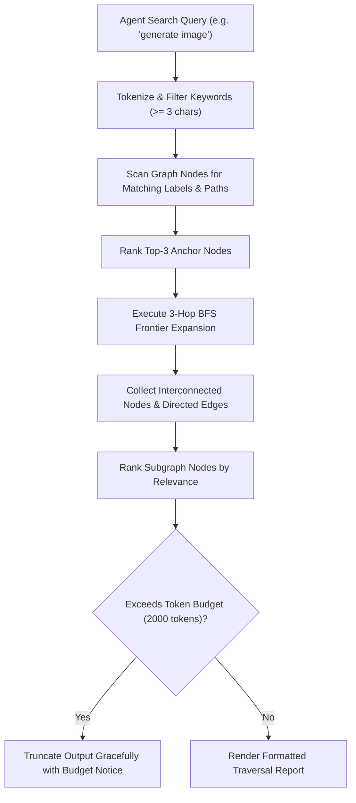

# 🔎 04 - Subgraph Query Engine & AI Agent Integration

> **Technical specification for the token-budgeted graph traversal query engine (`graphify-out/query.py`), multi-hop BFS/DFS frontier expansion algorithms, and AI agent refactoring workflows.**

---

## ⚡ 1. The Query Engine Architecture (`query.py`)

`graphify-out/query.py` enables AI coding assistants to extract localized, token-bounded topological subgraphs from `graph.json` without reading hundreds of raw source files:



---

## 💻 2. CLI Execution & Parameter Options

AI agents can execute `query.py` via standard Python shell execution:

```bash
python graphify-out/query.py
```

### Parameter Tuning:
- **`question`**: Query string (e.g. `'scan qr'`, `'preset logo'`, `'frame style'`).
- **`mode`**: Traversal strategy (`'bfs'` for broad architectural neighborhood or `'dfs'` for deep call-stack tracing).
- **`token_budget`**: Integer token limit (default `2000` tokens / `8000` characters).

---

## 📋 3. Real-World Query Traversal Examples

### Query 1: `'generate image'`
```
Traversal: BFS | Start: ['generate_qr_image()', 'generate_styled_qr()'] | 12 nodes
  NODE generate_qr_image() [src=services/qr_service.py loc=112-180]
  NODE generate_styled_qr() [src=qr_engine.py loc=41-160]
  NODE apply_canvas_effects() [src=services/qr_service.py loc=66-110]
  NODE hex_to_rgb() [src=engines/core/utils.py loc=8-18]
  NODE draw_eye_frame() [src=engines/eyes/eye_frames.py loc=33-140]
  NODE draw_eyeball() [src=engines/eyes/eyeballs.py loc=16-95]
  EDGE generate_qr_image() --calls [1.0]--> generate_styled_qr()
  EDGE generate_qr_image() --calls [1.0]--> apply_canvas_effects()
  EDGE generate_styled_qr() --calls [1.0]--> hex_to_rgb()
  EDGE generate_styled_qr() --calls [1.0]--> draw_eye_frame()
  EDGE generate_styled_qr() --calls [1.0]--> draw_eyeball()
```

---

### Query 2: `'scan qr'`
```
Traversal: BFS | Start: ['deep_scan_qr()', 'scan_qr_file()'] | 6 nodes
  NODE scan_qr_file() [src=routers/generator.py loc=248-275]
  NODE deep_scan_qr() [src=services/scan_service.py loc=39-160]
  NODE get_wechat_detector() [src=services/scan_service.py loc=13-30]
  NODE attempt_decode() [src=services/scan_service.py loc=31-38]
  EDGE scan_qr_file() --calls [1.0]--> deep_scan_qr()
  EDGE deep_scan_qr() --calls [1.0]--> get_wechat_detector()
  EDGE deep_scan_qr() --calls [1.0]--> attempt_decode()
```

---

## 🤖 4. AI Agent Refactoring Workflow with Graphify

Before modifying any function signature in `qr_engine.py` or `qr_service.py`:

```
Step 1: Run query.py to identify all incoming/outgoing dependencies for target function.
Step 2: Inspect all caller files returned in the subgraph report.
Step 3: Apply refactoring while maintaining backward compatibility for all dependent edges.
Step 4: Re-run build.py to verify that extraction succeeds and zero circular cycles are introduced.
```
